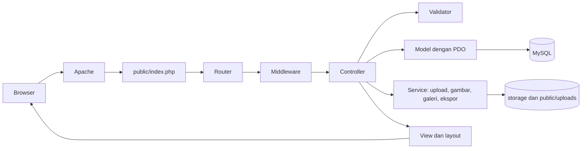

# ARCHITECTURE

Arsitektur teknis website Papua Future Project: **PHP native pola MVC, MySQL, dan deployment lewat cPanel Git**. Kebutuhan produk ada di [PRD.md](PRD.md), tabel di [ERD.md](ERD.md) dan [SCHEMA.md](SCHEMA.md), alur pengguna di [USERFLOW.md](USERFLOW.md), urutan pengerjaan di [STEP.md](STEP.md).

## 1. Stack

| Lapisan | Pilihan | Catatan |
| --- | --- | --- |
| Bahasa | PHP 8.4 ke atas, `declare(strict_types=1)` | Pilih versi lewat MultiPHP Manager di cPanel; verifikasi ketersediaannya pada paket hosting. |
| Pola | MVC buatan sendiri, ditambah lapisan Service | Tanpa framework (Laravel, CodeIgniter, dan sejenisnya). |
| Basis data | MySQL 8 atau MariaDB 10.6 ke atas lewat PDO | Prepared statement untuk semua query. |
| Web server | Apache dengan `mod_rewrite` (bawaan cPanel) | Contoh Nginx ada di bagian 14. |
| Dependensi | Composer: autoload PSR-4, PhpSpreadsheet, Dompdf | Library tambahan hanya dengan alasan tertulis. |
| Gambar | Ekstensi GD dengan dukungan WebP | Ubah ukuran, konversi, dan buang EXIF. |
| Tampilan | View PHP dengan layout dan partial | UI statis yang sudah ada dipecah menjadi layout, partial, dan view. |
| CSS dan JS | CSS dan JS biasa dalam file terpisah (tanpa bundler) | GSAP disajikan dari server sendiri. Lihat [GSAP.md](GSAP.md). |
| Autentikasi | Sesi PHP dengan cookie aman | Satu peran admin. |
| Validasi | Kelas `Validator` buatan sendiri di sisi server | Validasi di layar hanya pelengkap. |
| Hosting | cPanel dengan Git Version Control | Deployment lewat `.cpanel.yml` (bagian 13). |
| Zona waktu | `Asia/Jayapura` (WIT) | Diset di PHP dan di sesi MySQL. |

## 2. Alur sebuah permintaan



Satu aplikasi melayani halaman publik, panel admin, penyajian file privat, dan ekspor.

## 3. Struktur folder lengkap

Ini struktur target. Step 1 di [STEP.md](STEP.md) membuat seluruh folder dan file kerangka ini. Pohon menunjukkan layout repositori. Di server cPanel, isi `public/` berada di `public_html` dan folder lain berada di `pfp-app` (bagian 13).

```
pfp/
├─ AGENT.md                          panduan untuk AI agent
├─ bootstrap.php                     autoload dan konfigurasi lingkungan
├─ README.md                         cara menjalankan di lokal
├─ composer.json                     autoload PSR-4 App\ ke app/, dependensi
├─ composer.lock
├─ phpunit.xml
├─ phpcs.xml                         aturan PSR-12
├─ phpstan.neon
├─ .env.example                      contoh isi .env (tanpa rahasia)
├─ .gitignore
├─ .cpanel.yml                       tugas deployment cPanel Git
│
├─ bin/                              skrip CLI
│  ├─ migrate.php                    menjalankan file migrasi
│  ├─ create-database.php             membuat DB lokal (opsional, CLI)
│  ├─ create-admin.php                membuat akun admin awal secara aman
│  └─ cleanup-rate-limits.php         membersihkan rate_limits lama (cron)
│
├─ config/
│  ├─ app.php                        nama aplikasi, URL, zona waktu, sesi
│  ├─ routes.php                     tabel route (bagian 6)
│  └─ site.php                       data statis: kontak, sosial media, angka impact,
│                                    peta, wilayah, logo mitra, navigasi
│
├─ database/
│  ├─ pfp.sql                        skema lengkap untuk impor phpMyAdmin
│  ├─ migrations/
│  │  ├─ 0001_create_admin_users.sql
│  │  ├─ 0002_create_rate_limits.sql
│  │  ├─ 0003_create_about_content.sql
│  │  ├─ 0004_create_batches_and_team_members.sql
│  │  ├─ 0005_create_programs_and_photos.sql
│  │  ├─ 0006_create_posts_and_photos.sql
│  │  ├─ 0007_create_faqs_and_contact_messages.sql
│  │  └─ 0008_create_applications.sql
│  └─ seeds/
│     ├─ admin.php
│     ├─ about.php
│     ├─ team.php
│     ├─ programs.php
│     ├─ posts.php
│     └─ faqs.php
│
├─ app/
│  ├─ Core/
│  │  ├─ App.php                     bootstrap: env, sesi, router, penanganan galat
│  │  ├─ Router.php
│  │  ├─ Request.php                 satu-satunya pembaca superglobal
│  │  ├─ Response.php
│  │  ├─ View.php                    render View dengan layout
│  │  ├─ Database.php                koneksi PDO
│  │  ├─ Session.php
│  │  ├─ Flash.php                   pesan dan isian lama antar redirect
│  │  ├─ Csrf.php
│  │  ├─ Validator.php               mesin aturan validasi
│  │  ├─ Environment.php              pembaca .env
│  │  ├─ Logger.php
│  │  └─ helpers.php                 e(), url(), asset(), old(), error(), csrf_field(), active()
│  │
│  ├─ Support/
│  │  ├─ Labels.php                  pemetaan enum ke label antarmuka
│  │  ├─ Text.php                    paragraf dan **tebal** yang aman
│  │  ├─ Slug.php
│  │  └─ DateId.php                  tanggal berbahasa Indonesia
│  │
│  ├─ Middleware/
│  │  ├─ AuthMiddleware.php
│  │  ├─ CsrfMiddleware.php
│  │  └─ RateLimitMiddleware.php
│  │
│  ├─ Controllers/
│  │  ├─ Public/
│  │  │  ├─ HomeController.php
│  │  │  ├─ AboutController.php
│  │  │  ├─ ProgramController.php    index, show
│  │  │  ├─ PostController.php       index, show
│  │  │  ├─ JoinController.php       index, store, success
│  │  │  ├─ ContactController.php    index, store
│  │  │  └─ ErrorController.php      404 dan 500
│  │  └─ Admin/
│  │     ├─ AuthController.php
│  │     ├─ DashboardController.php
│  │     ├─ AboutController.php      cerita, visi, misi
│  │     ├─ TeamController.php       penggerak, internship, volunteer
│  │     ├─ BatchController.php      CRUD dan toggle
│  │     ├─ ProgramController.php
│  │     ├─ PostController.php
│  │     ├─ GalleryController.php    foto dokumentasi program dan berita
│  │     ├─ FaqController.php
│  │     ├─ ApplicationController.php
│  │     ├─ MessageController.php
│  │     ├─ FileController.php       menyajikan foto dan CV pendaftar
│  │     └─ ExportController.php
│  │
│  ├─ Models/
│  │  ├─ AdminUser.php
│  │  ├─ AboutContent.php
│  │  ├─ TeamMember.php
│  │  ├─ Batch.php
│  │  ├─ Program.php
│  │  ├─ ProgramPhoto.php
│  │  ├─ Post.php
│  │  ├─ PostPhoto.php
│  │  ├─ Faq.php
│  │  ├─ Application.php
│  │  ├─ ContactMessage.php
│  │  └─ RateLimit.php
│  │
│  ├─ Services/
│  │  ├─ AuthService.php
│  │  ├─ RateLimiter.php
│  │  ├─ UploadService.php           validasi dan pemindahan file unggahan
│  │  ├─ ImageService.php            GD: ubah ukuran, WebP, thumbnail, buang EXIF
│  │  ├─ GalleryService.php          tambah dan hapus foto, batas 30 foto
│  │  ├─ ApplicationService.php      alur pendaftaran (validasi, file, transaksi)
│  │  ├─ ExportService.php
│  │  └─ Export/
│  │     ├─ CsvExporter.php
│  │     ├─ XlsxExporter.php
│  │     └─ PdfExporter.php
│  │
│  ├─ Validators/
│  │  ├─ LoginValidator.php
│  │  ├─ AboutContentValidator.php
│  │  ├─ TeamMemberValidator.php
│  │  ├─ BatchValidator.php
│  │  ├─ ProgramValidator.php
│  │  ├─ PostValidator.php
│  │  ├─ FaqValidator.php
│  │  ├─ GalleryValidator.php
│  │  ├─ JoinApplicationValidator.php
│  │  ├─ ContactValidator.php
│  │  └─ ApplicationStatusValidator.php
│  │
│  └─ Views/
│     ├─ layouts/
│     │  ├─ public.php               header, main, footer, skrip publik
│     │  ├─ admin.php                sidebar saja, tanpa navbar atas
│     │  └─ admin-auth.php              layout halaman login
│     ├─ partials/
│     │  ├─ public/
│     │  │  ├─ head.php              meta, OG, CSS
│     │  │  ├─ header.php            logo, navigasi, tombol Jadi Relawan
│     │  │  ├─ footer.php
│     │  │  ├─ page-hero.php         judul dan subjudul halaman dalam
│     │  │  ├─ breadcrumb.php
│     │  │  ├─ gallery-grid.php      grid foto dokumentasi
│     │  │  ├─ post-card.php
│     │  │  ├─ program-card.php
│     │  │  ├─ team-card.php
│     │  │  ├─ flash.php
│     │  │  └─ cta-band.php
│     │  └─ admin/
│     │     ├─ sidebar-nav.php       dipakai sidebar desktop dan laci HP
│     │     ├─ page-header.php       judul, breadcrumb, aksi utama
│     │     ├─ toast.php
│     │     ├─ confirm-dialog.php
│     │     ├─ form-errors.php
│     │     ├─ pagination.php
│     │     ├─ status-pill.php
│     │     └─ gallery-manager.php   unggah, keterangan, urutan, hapus foto
│     ├─ public/
│     │  ├─ home/
│     │  │  ├─ index.php
│     │  │  └─ sections/             hero, about-short, founder, awards, impact,
│     │  │                          programs-preview, news-preview, region-map
│     │  ├─ about/
│     │  │  ├─ index.php
│     │  │  └─ sections/             story, timeline, photo-strip, vision-mission,
│     │  │                          team-core, team-batches
│     │  ├─ program/                 index.php, show.php
│     │  ├─ post/                    index.php, show.php
│     │  ├─ join/                    index.php, closed.php, success.php
│     │  ├─ contact/
│     │  │  ├─ index.php
│     │  │  └─ sections/             channels, location, form, partners, faq
│     │  └─ errors/                  404.php, 500.php
│     └─ admin/
│        ├─ auth/                    login.php
│        ├─ dashboard/               index.php
│        ├─ about/                   edit.php
│        ├─ team/                    index.php, form.php
│        ├─ batch/                   index.php, form.php
│        ├─ program/                 index.php, form.php
│        ├─ post/                    index.php, form.php
│        ├─ faq/                     index.php, form.php
│        ├─ application/             index.php, show.php, export-pdf.php
│        └─ message/                 index.php, show.php
│
├─ public/                           satu-satunya folder yang dilayani web server
│  ├─ index.php                      front controller
│  ├─ .htaccess
│  ├─ robots.txt
│  ├─ favicon.ico
│  ├─ assets/
│  │  ├─ css/
│  │  │  ├─ tokens.css               variabel warna, tipografi, jarak
│  │  │  ├─ base.css                 reset dan gaya elemen dasar
│  │  │  ├─ layout.css               container, header, footer, grid
│  │  │  ├─ components.css           tombol, pill, card, akordeon, form, breadcrumb
│  │  │  ├─ responsive.css             breakpoint publik dan menu mobile
│  │  │  ├─ pages/
│  │  │  │  ├─ home.css
│  │  │  │  ├─ about.css
│  │  │  │  ├─ program.css
│  │  │  │  ├─ program-detail.css
│  │  │  │  ├─ news.css
│  │  │  │  ├─ news-detail.css
│  │  │  │  ├─ join.css
│  │  │  │  ├─ contact.css
│  │  │  │  └─ errors.css
│  │  │  └─ admin/
│  │  │     ├─ admin-base.css
│  │  │     ├─ admin-layout.css      sidebar, area konten
│  │  │     ├─ admin-components.css  tabel, form, dialog, toast, pill
│  │  │     └─ admin-components.css
│  │  ├─ js/
│  │  │  ├─ js-flag.js               menambah kelas js pada html (dimuat di head)
│  │  │  ├─ main.js                  menu HP, header saat gulir, salin tautan
│  │  │  ├─ pages/
│  │  │  │  ├─ join.js               pratinjau file, pesan galat di layar
│  │  │  │  └─ contact.js
│  │  │  ├─ motion/                  lihat GSAP.md
│  │  │  │  ├─ tokens.js
│  │  │  │  ├─ index.js
│  │  │  │  ├─ hero-intro.js
│  │  │  │  ├─ count-up.js
│  │  │  │  ├─ reveal-group.js
│  │  │  │  └─ admin.js
│  │  │  ├─ admin/
│  │  │  │  └─ admin-forms.js        konfirmasi hapus, tombol menyimpan, pratinjau gambar
│  │  │  └─ vendor/
│  │  │     └─ gsap/                 gsap.min.js, ScrollTrigger.min.js
│  │  ├─ img/
│  │  │  ├─ logo.png
│  │  │  ├─ hero/                    herobanner.png
│  │  │  ├─ about/                   profilsingkat.png dan foto statis lain
│  │  │  ├─ team/                    Founder.jpg (sebelum ada di uploads)
│  │  │  ├─ partners/                unicef, kemenkes, astra
│  │  │  └─ og/                      gambar Open Graph
│  │  └─ fonts/
│  └─ uploads/                       tidak masuk Git, kecuali .htaccess dan .gitkeep
│     ├─ .htaccess                   memblokir eksekusi PHP
│     ├─ programs/{program_id}/
│     ├─ posts/{post_id}/
│     └─ team/
│
├─ storage/                          di luar public, tidak masuk Git
│  ├─ applications/{file_token}/     photo.webp dan cv.pdf
│  ├─ logs/                          app.log
│  └─ cache/
│
├─ tests/
│  ├─ Unit/                          Validator, Support, Model
│  └─ E2E/                           alur penting
│
└─ docs/                             semua dokumen md selain AGENT.md
│  ├─ PRD.md
│  ├─ ARCHITECTURE.md
│  ├─ ERD.md
│  ├─ SCHEMA.md
│  ├─ USERFLOW.md
│  ├─ DESIGN-ADMIN.md
│  ├─ RWD.md
│  ├─ GSAP.md
│  ├─ RULES.md
│  └─ STEP.md
```

Arsip HTML lama sudah dihapus setelah migrasi ke PHP MVC. Riwayat file tetap tersedia melalui Git.

## 4. Pemetaan halaman lama ke route baru

| File HTML lama | Route baru | Controller dan aksi | View |
| --- | --- | --- | --- |
| `index.html` | `/` | `Public\HomeController@index` | `public/home/index.php` |
| `about.html` | `/tentang` | `Public\AboutController@index` | `public/about/index.php` |
| `program.html` | `/program` | `Public\ProgramController@index` | `public/program/index.php` |
| `program-bimbel.html`, `program-digital.html`, `program-pojok-baca.html`, `program-kesehatan.html`, `program-pemuda.html` | `/program/{slug}` | `Public\ProgramController@show` | `public/program/show.php` |
| `berita.html` | `/berita` | `Public\PostController@index` | `public/post/index.php` |
| `berita-detail.html` | `/berita/{slug}` | `Public\PostController@show` | `public/post/show.php` |
| `join.html` | `/bergabung` | `Public\JoinController@index` | `public/join/index.php` atau `closed.php` |
| `kontak.html` | `/kontak` | `Public\ContactController@index` | `public/contact/index.php` |

Semua tautan internal memakai `url()`. Tidak boleh ada tautan yang berakhiran `.html`.

## 5. Tanggung jawab tiap lapisan

| Lapisan | Tugas | Tidak boleh |
| --- | --- | --- |
| Router (`config/routes.php`, `Core/Router`) | Mencocokkan metode HTTP dan jalur ke Controller, menempelkan Middleware. | Berisi logika bisnis. |
| Middleware | Memeriksa sesi admin, token CSRF, dan batas laju sebelum Controller jalan. | Mengakses View atau mengubah data. |
| Controller | Menerima `Request`, memanggil Validator, Model, dan Service, lalu memilih View atau redirect. Tipis. | Menulis SQL, mengolah file, atau membangun HTML. |
| Validator | Memeriksa dan membersihkan masukan, mengembalikan galat per field. | Mengakses database kecuali untuk aturan unik yang dibutuhkan. |
| Model | Satu kelas per tabel. Semua query PDO ada di sini. | Membaca `$_POST` atau `$_FILES`, atau mengeluarkan HTML. |
| Service | Logika yang menyentuh lebih dari satu Model atau menyentuh file: upload, gambar, galeri, pendaftaran, ekspor, autentikasi. | Membaca superglobal PHP langsung. |
| View | Menampilkan data. Boleh memakai `if`, `foreach`, dan helper `e()`. | Menjalankan query atau menghitung aturan bisnis. |
| Support | Fungsi kecil tanpa keadaan: label, format teks, slug, tanggal. | Mengakses database. |

`$_GET`, `$_POST`, `$_FILES`, `$_SERVER`, dan `$_COOKIE` hanya dibaca oleh kelas `Request`. Kode lain menerima nilai dari `Request`.

## 6. Peta route

Form HTML hanya mengenal GET dan POST, jadi ubah dan hapus memakai POST ke jalur khusus.

### Publik

| Metode | Jalur | Controller dan aksi | Middleware |
| --- | --- | --- | --- |
| GET | `/` | `Public\HomeController@index` | |
| GET | `/tentang` | `Public\AboutController@index` | |
| GET | `/program` | `Public\ProgramController@index` | |
| GET | `/program/{slug}` | `Public\ProgramController@show` | |
| GET | `/berita` | `Public\PostController@index` (filter `?kategori=kegiatan\|update\|media\|penghargaan`) | |
| GET | `/berita/{slug}` | `Public\PostController@show` | |
| GET | `/bergabung` | `Public\JoinController@index` | |
| POST | `/bergabung` | `Public\JoinController@store` | csrf, rate-limit `join` |
| GET | `/bergabung/berhasil` | `Public\JoinController@success` | |
| GET | `/kontak` | `Public\ContactController@index` | |
| POST | `/kontak` | `Public\ContactController@store` | csrf, rate-limit `contact` |

### Admin

| Metode | Jalur | Controller dan aksi | Middleware |
| --- | --- | --- | --- |
| GET | `/admin/login` | `Admin\AuthController@showLogin` | |
| POST | `/admin/login` | `Admin\AuthController@login` | csrf, rate-limit `login` |
| POST | `/admin/logout` | `Admin\AuthController@logout` | auth, csrf |
| GET | `/admin` | `Admin\DashboardController@index` | auth |
| GET | `/admin/tentang` | `Admin\AboutController@edit` | auth |
| POST | `/admin/tentang` | `Admin\AboutController@update` | auth, csrf |
| POST | `/admin/batch/{id}/toggle` | `Admin\BatchController@toggle` | auth, csrf |
| GET | `/admin/pendaftar` | `Admin\ApplicationController@index` | auth |
| GET | `/admin/pendaftar/{id}` | `Admin\ApplicationController@show` | auth |
| POST | `/admin/pendaftar/{id}/status` | `Admin\ApplicationController@updateStatus` | auth, csrf |
| GET | `/admin/berkas/{id}/{foto\|cv}` | `Admin\FileController@show` (`?unduh=1` memaksa unduhan) | auth |
| GET | `/admin/ekspor/{csv\|xlsx\|pdf}` | `Admin\ExportController@download` (filter lewat query string) | auth |
| GET | `/admin/pesan` | `Admin\MessageController@index` | auth |
| GET | `/admin/pesan/{id}` | `Admin\MessageController@show` (menandai sudah dibaca) | auth |
| POST | `/admin/pesan/{id}/hapus` | `Admin\MessageController@destroy` | auth, csrf |

### Pola CRUD

Berlaku untuk `program`, `berita`, `faq`, dan `batch`. Ganti `{entitas}` dengan nama jalurnya.

| Metode | Jalur | Aksi |
| --- | --- | --- |
| GET | `/admin/{entitas}` | `index` (daftar) |
| GET | `/admin/{entitas}/tambah` | `create` (form baru) |
| POST | `/admin/{entitas}` | `store` |
| GET | `/admin/{entitas}/{id}/ubah` | `edit` |
| POST | `/admin/{entitas}/{id}` | `update` |
| POST | `/admin/{entitas}/{id}/hapus` | `destroy` |

Untuk tim, pola yang sama berlaku di bawah `/admin/tim/{group}`, dengan `group` bernilai `penggerak`, `internship`, atau `volunteer`. `TeamController` memetakan `group` ke `CORE`, `INTERN`, dan `VOLUNTEER`, dan menjawab 404 untuk nilai lain.

### Foto dokumentasi

`GalleryController` melayani program dan berita. Ganti `{entitas}` dengan `program` atau `berita`.

| Metode | Jalur | Aksi |
| --- | --- | --- |
| POST | `/admin/{entitas}/{id}/foto` | `store` (unggah satu atau banyak foto, `photos[]`) |
| POST | `/admin/{entitas}/{id}/foto/{photoId}` | `update` (keterangan dan urutan) |
| POST | `/admin/{entitas}/{id}/foto/{photoId}/hapus` | `destroy` |

Semua rute di bawah `/admin` (kecuali login) memakai middleware `auth`, dan semua rute POST memakai `csrf`.

## 7. Alur penting

### 7.1 Pendaftaran dengan unggah file

1. Browser mengirim POST multipart ke `/bergabung`. Form membawa token CSRF dan satu kolom jebakan (honeypot) yang disembunyikan dengan CSS.
2. Middleware memeriksa CSRF dan batas laju `join` per IP (usulan: 5 percobaan per jam).
3. `JoinController@store` membaca masukan lewat `Request`, menolak diam-diam bila honeypot terisi, lalu memanggil `ApplicationService`.
4. `JoinApplicationValidator` memeriksa semua field teks (PRD bagian 8), memastikan `batch_id` ada dan sedang dibuka, dan menerapkan aturan bersyarat (asal universitas, usia minimal).
5. `UploadService` memeriksa setiap file: `UPLOAD_ERR_OK`, ukuran (foto 2 MB, CV 5 MB), tipe dari isi file dengan `finfo_file` (bukan dari ekstensi atau `Content-Type` kiriman browser), `getimagesize` untuk foto, dan awalan `%PDF-` untuk CV.
6. `ImageService` membaca foto dengan GD, mengecilkan sisi terpanjang menjadi maksimal 1200 px, lalu menyimpannya ulang sebagai WebP. Karena foto disimpan ulang dari data piksel, metadata EXIF (termasuk lokasi GPS) hilang.
7. Server membuat `file_token` acak (32 karakter heksadesimal dari `random_bytes`), lalu menulis `photo.webp` dan `cv.pdf` ke `storage/applications/{file_token}/` dengan izin folder 0750.
8. Model `Application` membuka transaksi, mengunci baris batch dengan `SELECT ... FOR UPDATE`, memastikan `is_open = 1`, lalu `INSERT`. Bila batch sudah ditutup atau email sudah terdaftar (galat 1062), transaksi dibatalkan dan folder file dihapus.
9. Setelah berhasil, redirect ke `/bergabung/berhasil` (pola Post/Redirect/Get). Bila gagal, simpan galat dan isian teks lama di flash session lalu redirect kembali ke `/bergabung#form-daftar`. File yang sudah dipilih harus dipilih ulang karena browser tidak bisa mengisi ulang input file.

### 7.2 Admin membuka file pendaftar

1. `AuthMiddleware` memastikan sesi admin sah. Tanpa sesi, arahkan ke `/admin/login` dan simpan tujuan awal agar admin kembali ke file itu setelah masuk.
2. `FileController@show` mencari `Application` dari `id`, lalu membentuk jalur dari `file_token` di database, tidak dari input pengguna.
3. Controller memastikan `realpath` file berada di bawah `STORAGE_DIR`. Bila tidak, jawab 404.
4. Respons membawa `Content-Type` sesuai file, `X-Content-Type-Options: nosniff`, dan `Cache-Control: private, no-store`. Tanpa `?unduh=1`, `Content-Disposition` bernilai `inline`. Dengan parameter itu, bernilai `attachment`. Nama file di header dibuat dari slug ASCII nama pendaftar, bukan nama asli unggahan.
5. File dikirim dengan `readfile`.

### 7.3 Unggah foto dokumentasi (galeri)

1. Admin membuka halaman ubah program atau berita, lalu mengirim POST multipart ke `/admin/{entitas}/{id}/foto` dengan `photos[]`.
2. `GalleryService` memastikan jumlah foto lama ditambah foto baru tidak melebihi 30, dan satu kali unggah tidak lebih dari 20 file.
3. Tiap file diperiksa: `UPLOAD_ERR_OK`, maksimal 8 MB, tipe JPEG, PNG, atau WebP dari isi file, dan `getimagesize`.
4. `ImageService` membaca orientasi EXIF lebih dulu (bila ekstensi `exif` ada) dan memutar gambar, lalu mengecilkan sisi terpanjang menjadi maksimal 1600 px dan menyimpan sebagai WebP kualitas sekitar 82. Versi kecil dengan sisi terpanjang 480 px disimpan dengan akhiran `-thumb.webp`.
5. Nama file dibuat dari `bin2hex(random_bytes(8))`, disimpan di `public/uploads/{programs|posts}/{id}/`.
6. Baris `program_photos` atau `post_photos` disimpan. Bila `INSERT` gagal, file yang sudah ditulis dihapus.
7. Menghapus foto menghapus baris dan kedua file (utama dan thumbnail). Menghapus program atau berita memanggil `GalleryService` untuk menghapus semua file lebih dulu.

### 7.4 Form kontak

1. Browser mengirim POST ke `/kontak`. Middleware memeriksa CSRF dan batas laju `contact` per IP (usulan: 5 per jam).
2. `ContactController@store` menolak diam-diam bila honeypot terisi, lalu menjalankan `ContactValidator`.
3. Model `ContactMessage` menyimpan pesan dengan `is_read = 0`.
4. Controller menyimpan pesan sukses di flash dan redirect ke `/kontak#kirim-pesan`. Bila gagal, galat dan isian lama dikirim lewat flash.

### 7.5 Ekspor

1. `ExportController@download` memeriksa sesi dan membaca filter (tipe, batch, status, pencarian) dari query string lewat `Request`.
2. **XLSX** (format utama): PhpSpreadsheet. Kolom tautan foto dan CV berisi hyperlink sel ke URL absolut dari `APP_URL` ke `/admin/berkas/{id}/foto` dan `/cv`. Kolom motivasi dan keahlian khusus diberi pembungkus teks. Larik bidang kontribusi digabung dengan koma.
3. **CSV**: ditulis dengan `fputcsv` ke `php://output`, diawali BOM UTF-8 agar huruf Indonesia terbaca benar di Excel. Pemisah kolom memakai titik koma, karena Excel dengan pengaturan regional Indonesia memakai titik koma sebagai pemisah daftar. Tautan di CSV berupa URL teks biasa.
4. **PDF**: Dompdf dari satu template View (`admin/application/export-pdf.php`). Tiap pendaftar mendapat satu blok berisi data teks, foto kecil (maksimal 160 px, dibuat dengan GD dan disisipkan sebagai data URI), dan tautan CV yang bisa diklik. Pengambilan sumber dari URL luar dimatikan.
5. Dompdf boros memori. Batasi satu PDF maksimal 100 pendaftar. Bila hasil filter lebih besar, tampilkan pesan agar admin mempersempit filter, misalnya per batch.

Tautan di file ekspor tetap meminta login admin saat dibuka. Ini disengaja, karena file ekspor bisa berpindah tangan.

## 8. Data statis (`config/site.php`)

Konten yang tidak dikelola admin (PRD A4) berada di `config/site.php` dan dibaca lewat fungsi `site('kunci')`.

| Kunci | Isi |
| --- | --- |
| `name`, `tagline`, `description` | Nama lembaga, "Every Child Matters", deskripsi footer. |
| `contact` | Email, alamat kantor, jam operasional, nomor telepon bila ada. |
| `social` | Instagram dan tautan sosial lain. |
| `impact` | Larik angka: anak (700, akhiran `+`), kampung (13), relawan (250, akhiran `+`), sejak (2020). |
| `region` | Daftar wilayah di peta, URL sematan OpenStreetMap, koordinat penanda, keterangan. |
| `partners` | Nama dan file logo mitra (UNICEF, Kemenkes RI, Astra). |
| `nav` | Daftar menu utama dan tombol Jadi Relawan. |

Teks yang panjang dan khas satu halaman (Sekilas tentang, Perjalanan kami, manfaat relawan, langkah bergabung) ditulis langsung di View bagian terkait.

## 9. Autentikasi dan otorisasi

- Kata sandi disimpan dengan `password_hash()` dan diperiksa dengan `password_verify()`. Setelah login berhasil, panggil `password_needs_rehash()` dan perbarui hash bila perlu.
- Sesi: aktifkan `session.use_strict_mode`, cookie `HttpOnly`, `Secure`, dan `SameSite=Lax`. Panggil `session_regenerate_id(true)` saat login. Hapus sesi sepenuhnya saat logout. Batasi masa tidak aktif (usulan: 2 jam).
- Login yang gagal memberi pesan yang sama untuk email salah dan kata sandi salah. Batas laju `login` dihitung per kombinasi IP dan email (usulan: 5 gagal per 15 menit).
- `AuthMiddleware` dipasang di semua rute `/admin/*` kecuali login. Controller admin tidak boleh mengandalkan "halaman ini tidak ditautkan dari mana pun".
- Hanya satu peran (admin). Bila peran bertambah, tambahkan kolom `role` di `admin_users` dan periksa di Middleware.

## 10. Keamanan

| Risiko | Penanganan |
| --- | --- |
| Injeksi SQL | Semua query lewat prepared statement PDO dengan `ATTR_EMULATE_PREPARES` dimatikan dan `ERRMODE_EXCEPTION`. Nama kolom untuk `ORDER BY` diambil dari daftar putih, tidak dari input. |
| XSS | Semua output di View melewati `e()`. Isi berita dan program disimpan sebagai teks dan dirender oleh `Text::render()`, yang meng-escape lebih dulu lalu hanya mengubah paragraf dan `**tebal**`. Tidak ada HTML dari admin. |
| CSRF | Token acak per sesi di setiap form POST, diperiksa dengan `hash_equals`. Cookie sesi `SameSite=Lax`. |
| Unggahan berbahaya | Periksa isi file (`finfo`, `getimagesize`, awalan `%PDF-`), batasi ukuran, nama file dibuat sistem, gambar disimpan ulang lewat GD, file pendaftar di luar `public/`. |
| Eksekusi file unggahan | `public/uploads/` memblokir eksekusi PHP (bagian 14). File pendaftar tidak ada di folder yang dilayani web server. |
| Spam form | Batas laju per IP dan kolom honeypot di form pendaftaran dan form kontak. Tambahkan captcha hanya bila spam tetap masuk. |
| Kebocoran data pribadi | File privat, `no-store`, EXIF dibuang, IP disimpan sebagai hash di `rate_limits`, log tidak memuat data pendaftar atau isi pesan. |
| Path traversal | Jalur file dibentuk dari `file_token` di database dan diperiksa dengan `realpath`. |
| Kebocoran konfigurasi | `.env` berada di luar `public/`. `display_errors` mati di produksi. Galat dicatat ke `storage/logs`. |
| Header | `X-Content-Type-Options: nosniff`, `Referrer-Policy: strict-origin-when-cross-origin`, `X-Frame-Options: SAMEORIGIN`, dan `Content-Security-Policy` (di bawah). |

Contoh `Content-Security-Policy` untuk halaman publik, diaktifkan setelah dependency UI eksternal ditangani:

```
default-src 'self'; img-src 'self' data:; script-src 'self'; style-src 'self'; frame-src https://www.openstreetmap.org; base-uri 'self'; form-action 'self'
```

Fase migrasi UI mempertahankan Tailwind Play CDN dari HTML lama untuk menjaga utility class tetap tampil tanpa mengubah desain. Sebelum kebijakan CSP di atas diaktifkan, ganti CDN tersebut dengan CSS Tailwind statis yang disimpan di `public/assets/css/`. Google Fonts juga masih dilayani dari domain eksternal; host font secara lokal atau tambahkan `font-src` dan `style-src` yang sesuai. Jangan menambahkan `'unsafe-inline'` untuk mengatasi dependency ini.

## 11. Data segar dan cache

Versi 1 tidak memakai cache halaman. Halaman publik dirender per permintaan dari database, sehingga perubahan admin langsung tampil. Query halaman publik ringan dan sudah berindeks.

Aset statis (CSS, JS, gambar) diberi versi lewat `?v=` dari waktu ubah file (fungsi `asset()`) dan disajikan dengan `Cache-Control` panjang. Gambar memakai `loading="lazy"`, kecuali foto hero.

## 12. Variabel lingkungan

Dibaca dari `.env` lewat kelas `Env`. Jangan memanggil `getenv()` di tempat lain. Salin `.env.example` menjadi `.env` di server dan isi manual. `.env` tidak masuk Git.

| Nama | Fungsi |
| --- | --- |
| `APP_ENV` | `local` atau `production`. Menentukan tampilan galat. |
| `APP_URL` | URL dasar situs, dipakai untuk tautan di file ekspor. |
| `APP_TIMEZONE` | Bawaan `Asia/Jayapura`. |
| `DB_HOST`, `DB_PORT`, `DB_NAME`, `DB_USER`, `DB_PASS` | Koneksi MySQL atau MariaDB. |
| `STORAGE_DIR` | Jalur absolut folder penyimpanan privat, di luar `public/`. |
| `SEED_ADMIN_EMAIL` | Email admin awal. |
| `SEED_ADMIN_PASSWORD` | Kata sandi admin awal. Ganti setelah login pertama. |

## 13. Deployment di cPanel dengan Git

Tujuan: `git push` ke repositori lalu klik "Deploy HEAD Commit" di cPanel memperbarui situs tanpa menyalin file manual.

### 13.1 Layout di server

```
/home/USERNAME/
├─ public_html/        isi folder public/ dari repositori (front controller, assets, uploads)
├─ pfp-app/            app, config, database, bin, vendor, storage, .env
└─ repositories/pfp/   salinan repositori yang dikelola cPanel Git
```

`public/index.php` mencari akar aplikasi di dua tempat, sehingga kode yang sama jalan di lokal dan di server:

```php
<?php

declare(strict_types=1);

// Layout repositori (lokal): akar aplikasi satu tingkat di atas public/.
// Layout cPanel: akar aplikasi ada di folder pfp-app di samping public_html.
$candidates = [dirname(__DIR__), dirname(__DIR__) . '/pfp-app'];

foreach ($candidates as $candidate) {
    if (is_file($candidate . '/app/Core/App.php')) {
        define('APP_ROOT', $candidate);
        break;
    }
}

if (!defined('APP_ROOT')) {
    http_response_code(500);
    exit('Aplikasi tidak ditemukan.');
}

define('PUBLIC_ROOT', __DIR__);

require APP_ROOT . '/vendor/autoload.php';

(new App\Core\App())->run();
```

### 13.2 Persiapan satu kali

1. Di cPanel, buka **MultiPHP Manager** dan pilih PHP 8.4 atau lebih baru untuk domain. Buka **Select PHP Version** dan aktifkan ekstensi `pdo_mysql`, `mbstring`, `fileinfo`, `gd`, `zip`, `xml`, `dom`, `simplexml`, `xmlwriter`, `xmlreader`, dan `exif`. Menu dan versi yang tersedia bergantung pada paket/provider; verifikasi pada akun hosting yang akan dipakai.
2. Buka **MultiPHP INI Editor** dan set: `upload_max_filesize = 8M`, `post_max_size = 32M`, `max_file_uploads = 20`, `memory_limit = 256M`, `display_errors = Off`.
3. Buat database dan pengguna MySQL di **MySQL Databases**, lalu beri semua hak pada database itu.
4. Buka **Git Version Control**, pilih **Create**, isi URL repositori (untuk repositori privat, pasang deploy key SSH), dan pilih jalur `repositories/pfp`.
5. Buat folder `/home/USERNAME/pfp-app` dan `.env` di dalamnya lewat File Manager, isi sesuai bagian 12 dengan `STORAGE_DIR=/home/USERNAME/pfp-app/storage` dan `APP_ENV=production`.
6. Pastikan AutoSSL aktif untuk domain.
7. Tambahkan cron di **Cron Jobs**: `0 3 * * * /usr/local/bin/ea-php84 /home/USERNAME/pfp-app/bin/cleanup-rate-limits.php`. Jalur PHP CLI berbeda antar hosting. Cek dengan `which ea-php84` atau tanyakan ke penyedia hosting; cron hanya diperlukan untuk cleanup terjadwal dan bukan proses yang harus terus hidup.

### 13.3 `.cpanel.yml`

Taruh di akar repositori dan commit. Ganti `USERNAME`. Jalur `composer` dan `ea-php84` berbeda antar hosting, jadi cek lewat Terminal cPanel dengan `which composer` dan `which ea-php84`.

```yaml
---
deployment:
  tasks:
    - export APP_DIR=/home/USERNAME/pfp-app
    - export WEB_DIR=/home/USERNAME/public_html
    - /bin/mkdir -p $APP_DIR/storage/logs $APP_DIR/storage/applications $APP_DIR/storage/sessions $APP_DIR/storage/cache
    - /usr/bin/rsync -a --delete app/ $APP_DIR/app/
    - /usr/bin/rsync -a --delete config/ $APP_DIR/config/
    - /usr/bin/rsync -a --delete database/ $APP_DIR/database/
    - /usr/bin/rsync -a --delete bin/ $APP_DIR/bin/
    - /bin/cp composer.json composer.lock $APP_DIR/
    - /usr/bin/rsync -a --include='uploads/' --include='uploads/.htaccess' --exclude='uploads/*' --exclude='.well-known/' --exclude='cgi-bin/' public/ $WEB_DIR/
    - cd $APP_DIR && /opt/cpanel/composer/bin/composer install --no-dev --optimize-autoloader --no-interaction
    - cd $APP_DIR && /usr/local/bin/ea-php84 bin/migrate.php
```

Penjelasan:

- `rsync --delete` hanya dipakai untuk folder kode, sehingga file yang dihapus dari repositori ikut hilang di server. Folder `storage/`, `vendor/`, dan `.env` tidak tersentuh karena tidak ada di daftar.
- `public/` disalin tanpa `--delete` dan tanpa isi `uploads/` (kecuali `.htaccess`-nya), sehingga foto yang sudah diunggah admin tidak terhapus.
- Bila `rsync` tidak tersedia, ganti dengan `/bin/cp -R app config database bin $APP_DIR/` dan hapus folder lama secara manual bila perlu.
- Bila Composer tidak tersedia di server, jalankan `composer install --no-dev` di lokal, hapus `vendor/` dari `.gitignore`, commit, dan hapus baris Composer dari tugas di atas.
- Pemicu deployment: di Git Version Control, klik **Update from Remote** lalu **Deploy HEAD Commit**. Deployment hanya jalan bila working tree bersih, jadi jangan mengedit file langsung di folder repositori.

### 13.4 Alur rilis

1. Kerja di cabang, gabung ke `main` lewat pull request.
2. Di cPanel, **Update from Remote**, lalu **Deploy HEAD Commit**.
3. Periksa halaman utama, login admin, dan satu unggah foto.
4. Bila gagal, lihat `pfp-app/storage/logs/app.log` dan log galat cPanel.

### 13.5 Cadangan

- Cadangkan database dengan `mysqldump` harian (cron atau fitur backup cPanel).
- Cadangkan folder `pfp-app/storage/` dan `public_html/uploads/` karena berisi file pendaftar dan foto galeri.
- Uji pemulihan sebelum peluncuran.
- Pantau ruang disk akun hosting, karena unggahan terus bertambah.

## 14. Konfigurasi web server

`public/.htaccess` (Apache di cPanel):

```apache
Options -Indexes
DirectoryIndex index.php

<IfModule mod_rewrite.c>
  RewriteEngine On

  # Paksa HTTPS di produksi, kecuali lokal dan validasi AutoSSL.
  RewriteCond %{HTTPS} off
  RewriteCond %{HTTP_HOST} !^localhost
  RewriteCond %{REQUEST_URI} !^/\.well-known/
  RewriteRule ^ https://%{HTTP_HOST}%{REQUEST_URI} [L,R=301]

  RewriteCond %{REQUEST_FILENAME} !-f
  RewriteCond %{REQUEST_FILENAME} !-d
  RewriteRule ^ index.php [L]
</IfModule>

<FilesMatch "^\.(?!well-known)">
  Require all denied
</FilesMatch>
```

`public/uploads/.htaccess` (blokir eksekusi skrip di folder unggahan):

```apache
Options -Indexes

<FilesMatch "\.(php|phtml|phar|php[0-9])$">
  Require all denied
</FilesMatch>
```

Contoh Nginx (bila suatu saat pindah dari cPanel), sesuaikan jalur dan versi PHP-FPM:

```nginx
server {
    server_name contoh.id;
    root /var/www/pfp/public;
    index index.php;
    client_max_body_size 32m;

    location / {
        try_files $uri /index.php?$query_string;
    }

    location ~ \.php$ {
        include fastcgi_params;
        fastcgi_param SCRIPT_FILENAME $document_root$fastcgi_script_name;
        fastcgi_pass unix:/run/php/php8.4-fpm.sock;
    }

    location ^~ /uploads/ {
        location ~ \.php$ {
            return 403;
        }
    }

    location ~ /\.(?!well-known) {
        deny all;
    }
}
```

## 15. Pengembangan lokal

```
composer install
Copy-Item .env.example .env   # isi koneksi database lokal
php bin/create-database.php   # opsional, buat database lokal
php bin/migrate.php
php bin/create-admin.php admin@example.com "Admin PFP" # password lewat PFP_ADMIN_PASSWORD
php -S localhost:8000 -t public public/index.php
```

## 16. Catatan keputusan

| Keputusan | Alasan | Konsekuensi |
| --- | --- | --- |
| PHP native dengan MVC buatan sendiri | Pilihan pemilik proyek. | Perlindungan yang biasanya disediakan framework (CSRF, validasi, escaping, sesi aman) harus dibuat dan dijaga sendiri. Aturannya ditulis eksplisit di [RULES.md](RULES.md). |
| Lapisan Service di atas MVC | Upload, gambar, galeri, dan ekspor menyentuh file dan banyak Model. | Controller tetap tipis dan mudah diuji. |
| Konten statis di `config/site.php` dan View | Tidak ada di daftar fitur admin yang disepakati. | Mengubah teks hero atau angka impact butuh perubahan kode. Bisa dibuatkan halaman admin di fase lanjut. |
| File pendaftar di luar `public/`, foto galeri di `public/uploads/` | Data pendaftar bersifat pribadi, foto galeri memang untuk publik. | Dua lokasi yang dicadangkan. |
| `file_token` acak untuk folder file pendaftar | Jalur tidak bisa ditebak dan tidak bergantung pada `id` yang baru ada setelah `INSERT`. | Satu folder acak per pendaftar. |
| Tanpa cache halaman di v1 | Skala kecil, perubahan admin harus langsung terlihat. | Perlu dievaluasi bila trafik naik. |
| Layout server terpisah (`public_html` dan `pfp-app`) | Hosting cPanel umumnya mengunci document root. | `index.php` mencari akar aplikasi di dua tempat. |
