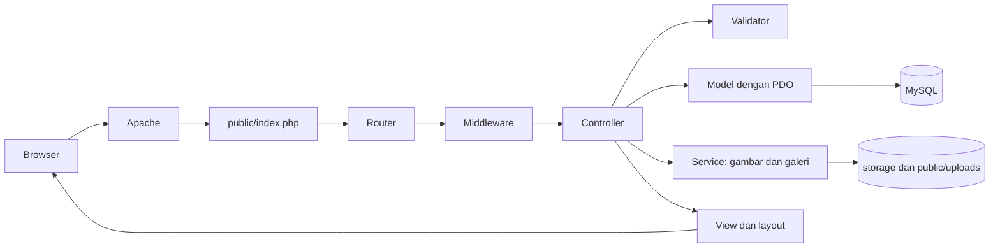

# ARCHITECTURE

Arsitektur teknis website Papua Future Project: **PHP native pola MVC, MySQL/MariaDB, dan shared hosting DirectAdmin**. Panduan deploy DirectAdmin tanpa SSH ada di [DEPLOY-DIRECTADMIN.md](DEPLOY-DIRECTADMIN.md); deployment cPanel Git di bagian 13 adalah alternatif. Kebutuhan produk ada di [PRD.md](PRD.md), tabel di [ERD.md](ERD.md) dan [SCHEMA.md](SCHEMA.md), alur pengguna di [USERFLOW.md](USERFLOW.md), urutan pengerjaan di [STEP.md](STEP.md).

## 1. Stack

| Lapisan | Pilihan | Catatan |
| --- | --- | --- |
| Bahasa | PHP 8.4 ke atas, `declare(strict_types=1)` | PHP 8.4 sudah dipilih di DirectAdmin; pastikan versi itu diterapkan pada domain/subdomain yang menjalankan PFP. |
| Pola | MVC buatan sendiri, ditambah lapisan Service | Tanpa framework (Laravel, CodeIgniter, dan sejenisnya). |
| Basis data | MySQL 8 atau MariaDB 10.6 ke atas lewat PDO | Prepared statement untuk semua query. |
| Web server | Apache/LiteSpeed dengan aturan rewrite, sesuai yang tersedia pada paket DirectAdmin | Tanyakan ke provider jika `.htaccess` tidak diterapkan; contoh Nginx ada di bagian 14. |
| Dependensi | Composer: autoload PSR-4, PhpSpreadsheet, Dompdf | Library tambahan hanya dengan alasan tertulis. |
| Gambar | Ekstensi GD dengan dukungan WebP | Ubah ukuran, konversi, dan buang EXIF. |
| Tampilan | View PHP dengan layout dan partial | UI statis yang sudah ada dipecah menjadi layout, partial, dan view. |
| CSS dan JS | CSS dan JS biasa dalam file terpisah (tanpa bundler) | GSAP disajikan dari server sendiri. Lihat [GSAP.md](GSAP.md). |
| Autentikasi | Sesi PHP dengan cookie aman | Satu peran admin. |
| Validasi | Kelas `Validator` buatan sendiri di sisi server | Validasi di layar hanya pelengkap. |
| Hosting | DirectAdmin shared hosting (target saat ini) | Deploy manual tanpa SSH lewat File Manager/FTP dan phpMyAdmin; lihat [DEPLOY-DIRECTADMIN.md](DEPLOY-DIRECTADMIN.md). cPanel Git tersedia sebagai alternatif di bagian 13. |
| Zona waktu | `Asia/Jayapura` (WIT) | Diset di PHP dan di sesi MySQL. |

## 2. Alur sebuah permintaan



Satu aplikasi melayani halaman publik dan panel admin. Pengunjung memilih batch; tautan pendaftaran membuka layanan formulir eksternal yang dipilih Admin. Aplikasi tidak menyimpan jawaban atau menyediakan halaman pendaftar dan ekspor.

## 3. Struktur folder lengkap

Ini struktur target. Step 1 di [STEP.md](STEP.md) membuat seluruh folder dan file kerangka ini. Pohon menunjukkan layout repositori. Di DirectAdmin, isi `public/` berada di document root dan folder privat berada di `pfp-app` di luar document root; lihat [DEPLOY-DIRECTADMIN.md](DEPLOY-DIRECTADMIN.md). Layout cPanel dijelaskan pada bagian 13.

```
pfp/
├─ AGENT.md                          panduan untuk AI agent
├─ bootstrap.php                     autoload dan konfigurasi lingkungan
├─ README.md                         cara menjalankan di lokal
├─ composer.json                     autoload PSR-4 App\ ke app/, dependensi
├─ composer.lock
├─ phpunit.xml
├─ phpcs.xml                         aturan PSR-12
├─ phpstan.neon
├─ .gitignore
├─ .cpanel.yml                       tugas deployment cPanel Git
│
├─ bin/                              skrip CLI
│  ├─ migrate.php                    menjalankan file migrasi
│  ├─ create-database.php             membuat DB lokal (opsional, CLI)
│  ├─ create-admin.php                membuat akun admin awal secara aman
│  ├─ cleanup-rate-limits.php         membersihkan rate_limits lama (cron)
│  └─ integrity-check.php             memeriksa perubahan file dan isi uploads (cron)
│
├─ config/
│  ├─ app.php                        nama aplikasi, URL, zona waktu, sesi
│  ├─ routes.php                     tabel route (bagian 6)
│  └─ site.php                       data statis: kontak, sosial media, angka impact,
│                                    peta, wilayah, logo mitra, navigasi
│
├─ database/
│  ├─ pfp.sql                        skema lengkap untuk impor phpMyAdmin
│  ├─ migrations/
│  │  ├─ 0001_create_admin_users.sql
│  │  ├─ 0002_create_rate_limits.sql
│  │  ├─ 0003_create_about_content.sql
│  │  ├─ 0004_create_batches_and_team_members.sql
│  │  ├─ 0005_create_programs_and_photos.sql
│  │  ├─ 0006_create_posts_and_photos.sql
│  │  ├─ 0007_create_faqs_and_contact_messages.sql
│  │  └─ 0008_create_applications.sql
│  └─ seeds/
│     ├─ admin.php
│     ├─ about.php
│     ├─ team.php
│     ├─ programs.php
│     ├─ posts.php
│     └─ faqs.php
│
├─ app/
│  ├─ Core/
│  │  ├─ App.php                     bootstrap: env, sesi, router, penanganan galat
│  │  ├─ Router.php
│  │  ├─ Request.php                 satu-satunya pembaca superglobal
│  │  ├─ Response.php
│  │  ├─ View.php                    render View dengan layout
│  │  ├─ Database.php                koneksi PDO
│  │  ├─ Cache.php                   cache data publik via APCu atau file
│  │  ├─ Session.php
│  │  ├─ Flash.php                   pesan dan isian lama antar redirect
│  │  ├─ Csrf.php
│  │  ├─ Validator.php               mesin aturan validasi
│  │  ├─ Environment.php              pembaca .env
│  │  ├─ Logger.php
│  │  ├─ SecurityLogger.php           catatan peristiwa keamanan tanpa data pribadi
│  │  └─ helpers.php                 e(), url(), asset(), old(), error(), csrf_field(), active()
│  │
│  ├─ Support/
│  │  ├─ Labels.php                  pemetaan enum ke label antarmuka
│  │  ├─ Text.php                    paragraf dan **tebal** yang aman
│  │  ├─ Slug.php
│  │  └─ DateId.php                  tanggal berbahasa Indonesia
│  │
│  ├─ Middleware/
│  │  ├─ AuthMiddleware.php
│  │  ├─ CsrfMiddleware.php
│  │  └─ RateLimitMiddleware.php
│  │
│  ├─ Controllers/
│  │  ├─ Public/
│  │  │  ├─ HomeController.php
│  │  │  ├─ AboutController.php
│  │  │  ├─ ProgramController.php    index, show
│  │  │  ├─ PostController.php       index, show
│  │  │  ├─ JoinController.php       pilihan batch dan redirect ke tautan formulir eksternal
│  │  │  ├─ ContactController.php    index, store
│  │  │  └─ ErrorController.php      404 dan 500
│  │  └─ Admin/
│  │     ├─ AuthController.php
│  │     ├─ DashboardController.php
│  │     ├─ AboutController.php      cerita, visi, misi
│  │     ├─ TeamController.php       penggerak, internship, volunteer
│  │     ├─ BatchController.php      CRUD dan toggle
│  │     ├─ ProgramController.php
│  │     ├─ PostController.php
│  │     ├─ GalleryController.php    foto dokumentasi program dan berita
│  │     ├─ FaqController.php
│  │     ├─ MessageController.php
│  │
│  ├─ Models/
│  │  ├─ AdminUser.php
│  │  ├─ AboutContent.php
│  │  ├─ TeamMember.php
│  │  ├─ Batch.php
│  │  ├─ Program.php
│  │  ├─ ProgramPhoto.php
│  │  ├─ Post.php
│  │  ├─ PostPhoto.php
│  │  ├─ Faq.php
│  │  ├─ ContactMessage.php
│  │  └─ RateLimit.php
│  │
│  ├─ Services/
│  │  ├─ AuthService.php
│  │  ├─ RateLimiter.php
│  │  ├─ UploadService.php           validasi dan pemindahan file unggahan
│  │  ├─ ImageService.php            GD: ubah ukuran, WebP, thumbnail, buang EXIF
│  │  ├─ GalleryService.php          tambah dan hapus foto, batas 30 foto
│  │
│  ├─ Validators/
│  │  ├─ LoginValidator.php
│  │  ├─ AboutContentValidator.php
│  │  ├─ TeamMemberValidator.php
│  │  ├─ BatchValidator.php
│  │  ├─ ProgramValidator.php
│  │  ├─ PostValidator.php
│  │  ├─ FaqValidator.php
│  │  ├─ GalleryValidator.php
│  │  ├─ ContactValidator.php
│  │
│  └─ Views/
│     ├─ layouts/
│     │  ├─ public.php               header, main, footer, skrip publik
│     │  ├─ admin.php                sidebar saja, tanpa navbar atas
│     │  └─ admin-auth.php              layout halaman login
│     ├─ partials/
│     │  ├─ public/
│     │  │  ├─ head.php              meta, OG, CSS
│     │  │  ├─ header.php            logo, navigasi, tombol Jadi Relawan
│     │  │  ├─ footer.php
│     │  │  ├─ page-hero.php         judul dan subjudul halaman dalam
│     │  │  ├─ breadcrumb.php
│     │  │  ├─ gallery-grid.php      grid foto dokumentasi
│     │  │  ├─ post-card.php
│     │  │  ├─ program-card.php
│     │  │  ├─ team-card.php
│     │  │  ├─ flash.php
│     │  │  └─ cta-band.php
│     │  └─ admin/
│     │     ├─ sidebar-nav.php       dipakai sidebar desktop dan laci HP
│     │     ├─ page-header.php       judul, breadcrumb, aksi utama
│     │     ├─ toast.php
│     │     ├─ confirm-dialog.php
│     │     ├─ form-errors.php
│     │     ├─ pagination.php
│     │     ├─ status-pill.php
│     │     └─ gallery-manager.php   unggah, keterangan, urutan, hapus foto
│     ├─ public/
│     │  ├─ home/
│     │  │  ├─ index.php
│     │  │  └─ sections/             hero, about-short, founder, awards, impact,
│     │  │                          programs-preview, news-preview, region-map
│     │  ├─ about/
│     │  │  ├─ index.php
│     │  │  └─ sections/             story, timeline, photo-strip, vision-mission,
│     │  │                          team-core, team-batches
│     │  ├─ program/                 index.php, show.php
│     │  ├─ post/                    index.php, show.php
│     │  ├─ join/                    index.php (pilihan batch dan link pendaftaran)
│     │  ├─ contact/
│     │  │  ├─ index.php
│     │  │  └─ sections/             channels, location, form, partners, faq
│     │  └─ errors/                  404.php, 500.php
│     └─ admin/
│        ├─ auth/                    login.php
│        ├─ dashboard/               index.php
│        ├─ about/                   edit.php
│        ├─ team/                    index.php, form.php
│        ├─ batch/                   index.php, form.php
│        ├─ program/                 index.php, form.php
│        ├─ post/                    index.php, form.php
│        ├─ faq/                     index.php, form.php
│        └─ message/                 index.php, show.php
│
├─ public/                           satu-satunya folder yang dilayani web server
│  ├─ index.php                      front controller
│  ├─ .htaccess
│  ├─ robots.txt
│  ├─ favicon.ico
│  ├─ assets/
│  │  ├─ css/
│  │  │  ├─ tokens.css               variabel warna, tipografi, jarak
│  │  │  ├─ base.css                 reset dan gaya elemen dasar
│  │  │  ├─ layout.css               container, header, footer, grid
│  │  │  ├─ components.css           tombol, pill, card, akordeon, form, breadcrumb
│  │  │  ├─ responsive.css             breakpoint publik dan menu mobile
│  │  │  ├─ pages/
│  │  │  │  ├─ home.css
│  │  │  │  ├─ about.css
│  │  │  │  ├─ program.css
│  │  │  │  ├─ program-detail.css
│  │  │  │  ├─ news.css
│  │  │  │  ├─ news-detail.css
│  │  │  │  ├─ join.css
│  │  │  │  ├─ contact.css
│  │  │  │  └─ errors.css
│  │  │  └─ admin/
│  │  │     ├─ admin-base.css
│  │  │     ├─ admin-layout.css      sidebar, area konten
│  │  │     ├─ admin-components.css  tabel, form, dialog, toast, pill
│  │  │     └─ admin-components.css
│  │  ├─ js/
│  │  │  ├─ js-flag.js               menambah kelas js pada html (dimuat di head)
│  │  │  ├─ main.js                  menu HP, header saat gulir, salin tautan
│  │  │  ├─ pages/
│  │  │  │  ├─ join.js               pratinjau file, pesan galat di layar
│  │  │  │  └─ contact.js
│  │  │  ├─ motion/                  lihat GSAP.md
│  │  │  │  ├─ tokens.js
│  │  │  │  ├─ index.js
│  │  │  │  ├─ hero-intro.js
│  │  │  │  ├─ count-up.js
│  │  │  │  ├─ reveal-group.js
│  │  │  │  └─ admin.js
│  │  │  ├─ admin/
│  │  │  │  └─ admin-forms.js        konfirmasi hapus, tombol menyimpan, pratinjau gambar
│  │  │  └─ vendor/
│  │  │     └─ gsap/                 gsap.min.js, ScrollTrigger.min.js
│  │  ├─ img/
│  │  │  ├─ logo.png
│  │  │  ├─ hero/                    herobanner.png
│  │  │  ├─ about/                   profilsingkat.png dan foto statis lain
│  │  │  ├─ team/                    Founder.jpg (sebelum ada di uploads)
│  │  │  ├─ partners/                unicef, kemenkes, astra
│  │  │  └─ og/                      gambar Open Graph
│  │  └─ fonts/
│  └─ uploads/                       tidak masuk Git, kecuali .htaccess dan .gitkeep
│     ├─ .htaccess                   memblokir eksekusi PHP
│     ├─ programs/{program_id}/
│     ├─ posts/{post_id}/
│     └─ team/
│
├─ storage/                          di luar public, tidak masuk Git
│  ├─ applications/                  arsip privat versi lama bila masih ada
│  ├─ logs/                          app.log
│  └─ cache/
│
├─ tests/
│  ├─ Unit/                          Validator, Support, Model
│  └─ E2E/                           alur penting
│
└─ docs/                             semua dokumen md selain AGENT.md
│  ├─ PRD.md
│  ├─ ARCHITECTURE.md
│  ├─ ERD.md
│  ├─ SCHEMA.md
│  ├─ USERFLOW.md
│  ├─ DESIGN-ADMIN.md
│  ├─ RWD.md
│  ├─ GSAP.md
│  ├─ RULES.md
│  └─ STEP.md
```

Arsip HTML lama sudah dihapus setelah migrasi ke PHP MVC. Riwayat file tetap tersedia melalui Git.

## 4. Pemetaan halaman lama ke route baru

| File HTML lama | Route baru | Controller dan aksi | View |
| --- | --- | --- | --- |
| `index.html` | `/` | `Public\HomeController@index` | `public/home/index.php` |
| `about.html` | `/tentang` | `Public\AboutController@index` | `public/about/index.php` |
| `program.html` | `/program` | `Public\ProgramController@index` | `public/program/index.php` |
| `program-bimbel.html`, `program-digital.html`, `program-pojok-baca.html`, `program-kesehatan.html`, `program-pemuda.html` | `/program/{slug}` | `Public\ProgramController@show` | `public/program/show.php` |
| `berita.html` | `/berita` | `Public\PostController@index` | `public/post/index.php` |
| `berita-detail.html` | `/berita/{slug}` | `Public\PostController@show` | `public/post/show.php` |
| `join.html` | `/bergabung` | `Public\JoinController@index` | `public/join/index.php` (pilihan jalur dan batch aktif) |
| `kontak.html` | `/kontak` | `Public\ContactController@index` | `public/contact/index.php` |

Semua tautan internal memakai `url()`. Tidak boleh ada tautan yang berakhiran `.html`.

## 5. Tanggung jawab tiap lapisan

| Lapisan | Tugas | Tidak boleh |
| --- | --- | --- |
| Router (`config/routes.php`, `Core/Router`) | Mencocokkan metode HTTP dan jalur ke Controller, menempelkan Middleware. | Berisi logika bisnis. |
| Middleware | Memeriksa sesi admin, token CSRF, dan batas laju sebelum Controller jalan. | Mengakses View atau mengubah data. |
| Controller | Menerima `Request`, memanggil Validator, Model, dan Service, lalu memilih View atau redirect. Tipis. | Menulis SQL, mengolah file, atau membangun HTML. |
| Validator | Memeriksa dan membersihkan masukan, mengembalikan galat per field. | Mengakses database kecuali untuk aturan unik yang dibutuhkan. |
| Model | Satu kelas per tabel. Semua query PDO ada di sini. | Membaca `$_POST` atau `$_FILES`, atau mengeluarkan HTML. |
| Service | Logika yang menyentuh file atau beberapa Model: gambar, galeri, autentikasi. | Membaca superglobal PHP langsung. |
| View | Menampilkan data. Boleh memakai `if`, `foreach`, dan helper `e()`. | Menjalankan query atau menghitung aturan bisnis. |
| Support | Fungsi kecil tanpa keadaan: label, format teks, slug, tanggal. | Mengakses database. |

`$_GET`, `$_POST`, `$_FILES`, `$_SERVER`, dan `$_COOKIE` hanya dibaca oleh kelas `Request`. Kode lain menerima nilai dari `Request`.

Pengaturan pendaftaran baru memakai Batch sebagai satu-satunya panel admin:

| File | Tanggung jawab |
| --- | --- |
| `app/Controllers/Admin/BatchController.php` | CRUD batch dan sakelar buka/tutup per batch. |
| `app/Models/Batch.php` | Menyimpan `google_form_url` dan `is_open` pada setiap batch. |
| `app/Validators/BatchValidator.php` | Memvalidasi tautan pendaftaran sebagai URL web absolut HTTP/HTTPS sebelum disimpan atau dibuka. |
| `app/Views/admin/batch/` | Daftar batch dengan toggle dan formulir edit untuk nama serta URL. |
| `app/Controllers/Public/JoinController.php` | Menampilkan batch publik dan mengalihkan ke URL batch yang masih terbuka. |
| `database/pfp.sql` | Menambah URL per batch dan memindahkan URL lama tanpa menghapus data historis. |

Pengelolaan akun admin memakai `app/Controllers/Admin/AdminAccountController.php`, model `app/Models/AdminUser.php`, validator `app/Validators/AdminAccountValidator.php`, dan dua View di `app/Views/admin/accounts/`. Tidak ada perubahan skema; seluruh akun tersimpan di tabel `admin_users`.

## 6. Peta route

Form HTML hanya mengenal GET dan POST, jadi ubah dan hapus memakai POST ke jalur khusus.

### Publik

| Metode | Jalur | Controller dan aksi | Middleware |
| --- | --- | --- | --- |
| GET | `/` | `Public\HomeController@index` | |
| GET | `/tentang` | `Public\AboutController@index` | |
| GET | `/program` | `Public\ProgramController@index` | |
| GET | `/program/{slug}` | `Public\ProgramController@show` | |
| GET | `/berita` | `Public\PostController@index` (filter `?kategori=kegiatan\|update\|media\|penghargaan`) | |
| GET | `/berita/{slug}` | `Public\PostController@show` | |
| GET | `/bergabung` | `Public\JoinController@index` | |
| GET | `/bergabung/{internship\|relawan}/{batchId}` | `Public\JoinController@form` (cek status batch lalu alihkan ke tautan pendaftaran) | |
| GET | `/kontak` | `Public\ContactController@index` | |
| POST | `/kontak` | `Public\ContactController@store` | csrf, rate-limit `contact` |

### Admin

| Metode | Jalur | Controller dan aksi | Middleware |
| --- | --- | --- | --- |
| GET | `/admin/login` | `Admin\AuthController@showLogin` | |
| POST | `/admin/login` | `Admin\AuthController@login` | csrf, rate-limit `login` |
| POST | `/admin/logout` | `Admin\AuthController@logout` | auth, csrf |
| GET | `/admin` | `Admin\DashboardController@index` | auth |
| GET/POST | `/admin/akun` | `Admin\AdminAccountController@index/create` | auth; csrf untuk POST |
| GET/POST | `/admin/akun/password` | `Admin\AdminAccountController@passwordForm/updatePassword` | auth; csrf untuk POST |
| GET | `/admin/tentang` | `Admin\AboutController@edit` | auth |
| POST | `/admin/tentang` | `Admin\AboutController@update` | auth, csrf |
| GET/POST | `/admin/batch`, `/admin/batch/{id}` | `Admin\BatchController` (daftar, tambah, ubah, hapus) | auth; csrf untuk POST |
| POST | `/admin/batch/{id}/toggle` | `Admin\BatchController@toggle` | auth, csrf |
| GET | `/admin/pesan` | `Admin\MessageController@index` | auth |
| GET | `/admin/pesan/{id}` | `Admin\MessageController@show` (menandai sudah dibaca) | auth |
| POST | `/admin/pesan/{id}/hapus` | `Admin\MessageController@destroy` | auth, csrf |

### Pola CRUD

Berlaku untuk `program`, `berita`, `faq`, dan `batch`. Ganti `{entitas}` dengan nama jalurnya.

| Metode | Jalur | Aksi |
| --- | --- | --- |
| GET | `/admin/{entitas}` | `index` (daftar) |
| GET | `/admin/{entitas}/tambah` | `create` (form baru) |
| POST | `/admin/{entitas}` | `store` |
| GET | `/admin/{entitas}/{id}/ubah` | `edit` |
| POST | `/admin/{entitas}/{id}` | `update` |
| POST | `/admin/{entitas}/{id}/hapus` | `destroy` |

Untuk tim, pola yang sama berlaku di bawah `/admin/tim/{group}`, dengan `group` bernilai `penggerak`, `internship`, atau `volunteer`. `TeamController` memetakan `group` ke `CORE`, `INTERN`, dan `VOLUNTEER`, dan menjawab 404 untuk nilai lain.

### Foto dokumentasi

`GalleryController` melayani program dan berita. Ganti `{entitas}` dengan `program` atau `berita`.

| Metode | Jalur | Aksi |
| --- | --- | --- |
| POST | `/admin/{entitas}/{id}/foto` | `store` (unggah satu atau banyak foto, `photos[]`) |
| POST | `/admin/{entitas}/{id}/foto/{photoId}` | `update` (keterangan dan urutan) |
| POST | `/admin/{entitas}/{id}/foto/{photoId}/hapus` | `destroy` |

Semua rute di bawah `/admin` (kecuali login) memakai middleware `auth`, dan semua rute POST memakai `csrf`.

## 7. Alur penting

### 7.1 Pendaftaran melalui layanan formulir eksternal

1. Pengunjung membuka `/bergabung` dan melihat batch yang statusnya terbuka.
2. Tombol Daftar tampil jika URL pendaftaran tersimpan dan batch terkait terbuka.
3. Klik Daftar membuka URL yang dipilih Admin pada tab baru. Pertanyaan, unggahan, validasi, penyimpanan jawaban, dan halaman konfirmasi ditangani oleh layanan pada tautan tersebut.
4. Rute `/bergabung/{internship|relawan}/{batchId}` memeriksa status dan URL batch sebelum mengarahkan pengunjung. Rute formulir lokal dan halaman konfirmasi lama tidak tersedia.

Admin menyimpan URL di kolom kompatibilitas `batches.google_form_url` dan membuka/menutupnya melalui `batches.is_open`. URL dari domain mana pun diterima selama berupa URL absolut yang valid dengan skema `http` atau `https`, tanpa kredensial username/password. Link kosong menutup batch. Setiap batch berdiri sendiri, sehingga beberapa batch Internship dan Relawan dapat dibuka bersamaan.

### 7.2 Data formulir website versi lama

Pendaftaran website versi lama sudah dinonaktifkan. Halaman admin untuk melihat data pendaftar, file foto/CV, dan ekspor tidak tersedia. Tabel `applications`, `application_answers`, `application_questions`, dan `application_form_settings` dipertahankan sebagai arsip skema agar pembaruan `database/pfp.sql` tidak menghapus data lama. Pendaftaran baru, file, dan ekspor dikelola di layanan formulir yang ditautkan.

### 7.3 Unggah foto dokumentasi (galeri)

1. Admin membuka halaman ubah program atau berita, lalu mengirim POST multipart ke `/admin/{entitas}/{id}/foto` dengan `photos[]`.
2. `GalleryService` memastikan jumlah foto lama ditambah foto baru tidak melebihi 30, dan satu kali unggah tidak lebih dari 20 file.
3. Tiap file diperiksa: `UPLOAD_ERR_OK`, maksimal 8 MB, tipe JPEG, PNG, atau WebP dari isi file, dan `getimagesize`.
4. `ImageService` membaca orientasi EXIF lebih dulu (bila ekstensi `exif` ada) dan memutar gambar, lalu mengecilkan sisi terpanjang menjadi maksimal 1600 px dan menyimpan sebagai WebP kualitas sekitar 82. Versi kecil dengan sisi terpanjang 480 px disimpan dengan akhiran `-thumb.webp`.
5. Nama file dibuat dari `bin2hex(random_bytes(8))`, disimpan di `public/uploads/{programs|posts}/{id}/`.
6. Baris `program_photos` atau `post_photos` disimpan. Bila `INSERT` gagal, file yang sudah ditulis dihapus.
7. Menghapus foto menghapus baris dan kedua file (utama dan thumbnail). Menghapus program atau berita memanggil `GalleryService` untuk menghapus semua file lebih dulu.

### 7.4 Form kontak

1. Browser mengirim POST ke `/kontak`. Middleware memeriksa CSRF dan batas laju `contact` per IP (usulan: 5 per jam).
2. `ContactController@store` menolak diam-diam bila honeypot terisi, lalu menjalankan `ContactValidator`.
3. Model `ContactMessage` menyimpan pesan dengan `is_read = 0`.
4. Controller menyimpan pesan sukses di flash dan redirect ke `/kontak#kirim-pesan`. Bila gagal, galat dan isian lama dikirim lewat flash.

### 7.5 Ekspor jawaban pendaftaran

Ekspor jawaban pendaftaran tidak dibuat oleh aplikasi PFP. Admin menggunakan fitur ekspor dari layanan formulir yang ditautkan; kode dan rute ekspor pendaftar versi lama tidak menjadi bagian fitur aktif.

## 8. Data statis (`config/site.php`)

Konten yang tidak dikelola admin (PRD A4) berada di `config/site.php` dan dibaca lewat fungsi `site('kunci')`.

| Kunci | Isi |
| --- | --- |
| `name`, `tagline`, `description` | Nama lembaga, "Every Child Matters", deskripsi footer. |
| `contact` | Email, alamat kantor, jam operasional, nomor telepon bila ada. |
| `social` | Instagram dan tautan sosial lain. |
| `impact` | Larik angka: anak (700, akhiran `+`), kampung (13), relawan (250, akhiran `+`), sejak (2020). |
| `region` | Daftar wilayah di peta, URL sematan OpenStreetMap, koordinat penanda, keterangan. |
| `partners` | Nama dan file logo mitra (UNICEF, Kemenkes RI, Astra). |
| `nav` | Daftar menu utama dan tombol Jadi Relawan. |

Teks yang panjang dan khas satu halaman (Sekilas tentang, Perjalanan kami, manfaat relawan, langkah bergabung) ditulis langsung di View bagian terkait.

## 9. Autentikasi dan otorisasi

- Kata sandi disimpan dengan `password_hash()` dan diperiksa dengan `password_verify()`. Setelah login berhasil, panggil `password_needs_rehash()` dan perbarui hash bila perlu.
- Sesi: aktifkan `session.use_strict_mode`, cookie `HttpOnly`, `Secure`, dan `SameSite=Lax`. Panggil `session_regenerate_id(true)` saat login. Hapus sesi sepenuhnya saat logout. Batasi masa tidak aktif (usulan: 2 jam).
- Login yang gagal memberi pesan yang sama untuk email salah dan kata sandi salah. Batas laju `login` dihitung per kombinasi IP dan email (usulan: 5 gagal per 15 menit).
- `AuthMiddleware` dipasang di semua rute `/admin/*` kecuali login. Controller admin tidak boleh mengandalkan "halaman ini tidak ditautkan dari mana pun".
- Hanya satu peran (admin). Bila peran bertambah, tambahkan kolom `role` di `admin_users` dan periksa di Middleware.

## 10. Keamanan

| Risiko | Penanganan |
| --- | --- |
| Injeksi SQL | Semua query lewat prepared statement PDO dengan `ATTR_EMULATE_PREPARES` dimatikan dan `ERRMODE_EXCEPTION`. Nama kolom untuk `ORDER BY` diambil dari daftar putih, tidak dari input. |
| XSS | Semua output di View melewati `e()`. Isi berita dan program disimpan sebagai teks dan dirender oleh `Text::render()`, yang meng-escape lebih dulu lalu hanya mengubah paragraf dan `**tebal**`. Tidak ada HTML dari admin. |
| CSRF | Token acak per sesi di setiap form POST, diperiksa dengan `hash_equals`. Cookie sesi `SameSite=Lax`. |
| Unggahan berbahaya | Periksa isi dan ukuran foto galeri, nama file dibuat sistem, gambar disimpan ulang lewat GD. Form pendaftaran dan berkasnya dikelola layanan eksternal. |
| Eksekusi file unggahan | `public/uploads/` memblokir eksekusi PHP (bagian 14). Arsip foto/CV lokal lama tetap di luar folder yang dilayani web server. |
| Spam form | Batas laju per IP pada form kontak. Pembatasan pendaftaran ditangani layanan formulir eksternal. |
| Kebocoran data pribadi | Arsip lokal lama tetap privat; EXIF dibuang pada foto publik; IP disimpan sebagai hash di `rate_limits`; log tidak memuat data pribadi atau isi pesan. |
| Path traversal | File galeri dibentuk dari jalur yang dikelola aplikasi. Arsip file pendaftar lama tidak memiliki endpoint penyajian. |
| Kebocoran konfigurasi | `.env` berada di luar `public/`. `display_errors` mati di produksi. Galat dicatat ke `storage/logs`. |
| Header | `X-Content-Type-Options: nosniff`, `Referrer-Policy: strict-origin-when-cross-origin`, `X-Frame-Options: SAMEORIGIN`, dan `Content-Security-Policy` (di bawah). |

Contoh `Content-Security-Policy` untuk halaman publik, diaktifkan setelah dependency UI eksternal ditangani:

```
default-src 'self'; img-src 'self' data:; script-src 'self'; style-src 'self'; frame-src https://www.openstreetmap.org; base-uri 'self'; form-action 'self'
```

Fase migrasi UI mempertahankan Tailwind Play CDN dari HTML lama untuk menjaga utility class tetap tampil tanpa mengubah desain. Sebelum kebijakan CSP di atas diaktifkan, ganti CDN tersebut dengan CSS Tailwind statis yang disimpan di `public/assets/css/`. Google Fonts juga masih dilayani dari domain eksternal; host font secara lokal atau tambahkan `font-src` dan `style-src` yang sesuai. Jangan menambahkan `'unsafe-inline'` untuk mengatasi dependency ini.

## 11. Data segar dan cache

Model menggunakan cache data publik selama 60 detik. APCu dipakai bila tersedia; bila tidak, cache memakai file di `storage/cache/`, sehingga tetap bekerja pada shared hosting tanpa Redis atau ekstensi tambahan. Cache hanya mencakup konten publik (Tentang Kami, tim yang dipublikasikan, batch publik, program, berita, foto dokumentasi, dan FAQ). Data login, pesan kontak, dan seluruh halaman admin tidak disimpan dalam cache.

Perubahan konten melalui panel admin membersihkan cache publik setelah berhasil disimpan. Perubahan langsung di phpMyAdmin akan terlihat setelah cache berakhir, paling lama 60 detik. `storage/.htaccess` menutup akses web ke file cache.

Aset statis (CSS, JS, gambar) diberi versi lewat `?v=` dari waktu ubah file (fungsi `asset()`) dan disajikan dengan `Cache-Control` panjang. Query publik memakai indeks untuk kolom filter dan pengurutan; query daftar program dan berita hanya mengambil kolom kartu, bukan kolom isi `MEDIUMTEXT`. Gambar memakai `loading="lazy"`, kecuali foto hero.

## 12. Variabel lingkungan

Dibaca dari satu file `.env` di akar proyek lewat kelas `Environment`. File `.env` bersifat khusus untuk tiap lingkungan dan tidak masuk Git. Di instalasi baru, buat file tersebut dan isi variabel berikut.

| Nama | Fungsi |
| --- | --- |
| `APP_NAME` | Nama aplikasi yang ditampilkan. |
| `APP_ENV` | `local` atau `production`. Menentukan tampilan galat. |
| `APP_DEBUG` | `true` hanya untuk pengembangan lokal; gunakan `false` di production. |
| `APP_URL` | URL dasar situs, dipakai untuk tautan internal dan metadata situs. |
| `APP_KEY` | 32 byte acak heksadesimal untuk HMAC identifier pembatas laju dan hash IP log keamanan. |
| `ADMIN_PATH` | Jalur acak panel admin; wajib di production, diabaikan di local. |
| `APP_TIMEZONE` | Bawaan `Asia/Jayapura`. |
| `DB_HOST`, `DB_PORT`, `DB_NAME`, `DB_USER`, `DB_PASS` | Koneksi MySQL atau MariaDB. |
| `STORAGE_DIR` | Opsional; lokasi penyimpanan privat. Kosong memakai folder `storage/` di akar proyek. |
| `STORAGE_DIR` | Jalur absolut folder penyimpanan privat, di luar `public/`. |
| `SEED_ADMIN_EMAIL` | Email admin awal. |
| `SEED_ADMIN_PASSWORD` | Kata sandi admin awal. Ganti setelah login pertama. |

## 13. Deployment di cPanel dengan Git

Bagian ini adalah alternatif untuk akun cPanel yang memiliki Git Version Control dan terminal. Target akun hosting saat ini adalah DirectAdmin; ikuti [DEPLOY-DIRECTADMIN.md](DEPLOY-DIRECTADMIN.md) untuk langkah yang sesuai dengan kondisi saat ini (tanpa SSH). Jangan jalankan prosedur `.cpanel.yml` pada DirectAdmin.

Tujuan: `git push` ke repositori lalu klik "Deploy HEAD Commit" di cPanel memperbarui situs tanpa menyalin file manual.

### 13.1 Layout di server

```
/home/USERNAME/
├─ public_html/        isi folder public/ dari repositori (front controller, assets, uploads)
├─ pfp-app/            app, config, database, bin, vendor, storage, .env
└─ repositories/pfp/   salinan repositori yang dikelola cPanel Git
```

`public/index.php` mencari akar aplikasi di dua tempat, sehingga kode yang sama jalan di lokal dan di server:

```php
<?php

declare(strict_types=1);

// Layout repositori (lokal): akar aplikasi satu tingkat di atas public/.
// Layout cPanel: akar aplikasi ada di folder pfp-app di samping public_html.
$candidates = [dirname(__DIR__), dirname(__DIR__) . '/pfp-app'];

foreach ($candidates as $candidate) {
    if (is_file($candidate . '/app/Core/App.php')) {
        define('APP_ROOT', $candidate);
        break;
    }
}

if (!defined('APP_ROOT')) {
    http_response_code(500);
    exit('Aplikasi tidak ditemukan.');
}

define('PUBLIC_ROOT', __DIR__);

require APP_ROOT . '/vendor/autoload.php';

(new App\Core\App())->run();
```

### 13.2 Persiapan satu kali

1. Di cPanel, buka **MultiPHP Manager** dan pilih PHP 8.4 atau lebih baru untuk domain. Buka **Select PHP Version** dan aktifkan ekstensi `pdo_mysql`, `mbstring`, `fileinfo`, `gd`, `zip`, `xml`, `dom`, `simplexml`, `xmlwriter`, `xmlreader`, dan `exif`. Menu dan versi yang tersedia bergantung pada paket/provider; verifikasi pada akun hosting yang akan dipakai.
2. Buka **MultiPHP INI Editor** dan set: `upload_max_filesize = 8M`, `post_max_size = 32M`, `max_file_uploads = 20`, `memory_limit = 256M`, `display_errors = Off`.
3. Buat database dan pengguna MySQL di **MySQL Databases**, lalu beri semua hak pada database itu.
4. Buka **Git Version Control**, pilih **Create**, isi URL repositori (untuk repositori privat, pasang deploy key SSH), dan pilih jalur `repositories/pfp`.
5. Buat folder `/home/USERNAME/pfp-app` dan `.env` di dalamnya lewat File Manager, isi sesuai bagian 12 dengan `STORAGE_DIR=/home/USERNAME/pfp-app/storage`, `APP_ENV=production`, `APP_DEBUG=false`, `APP_URL=https://domain-anda`, `APP_KEY` acak, dan `ADMIN_PATH` acak.
6. Pastikan AutoSSL aktif untuk domain.
7. Tambahkan cron di **Cron Jobs**: cleanup harian `0 3 * * * /usr/local/bin/ea-php84 /home/USERNAME/pfp-app/bin/cleanup-rate-limits.php` dan integrity check `0 */6 * * * /usr/local/bin/ea-php84 /home/USERNAME/pfp-app/bin/integrity-check.php`. Jalur PHP CLI berbeda antar hosting. Cek dengan `which ea-php84` atau tanyakan ke penyedia hosting; cron hanya diperlukan untuk tugas terjadwal dan bukan proses yang harus terus hidup.

### 13.3 `.cpanel.yml`

Taruh di akar repositori dan commit. Ganti `USERNAME`. Jalur `composer` dan `ea-php84` berbeda antar hosting, jadi cek lewat Terminal cPanel dengan `which composer` dan `which ea-php84`.

```yaml
---
deployment:
  tasks:
    - export APP_DIR=/home/USERNAME/pfp-app
    - export WEB_DIR=/home/USERNAME/public_html
    - /bin/mkdir -p $APP_DIR/storage/logs $APP_DIR/storage/sessions $APP_DIR/storage/cache
    - /bin/cp storage/.htaccess $APP_DIR/storage/.htaccess
    - /usr/bin/rsync -a --delete app/ $APP_DIR/app/
    - /usr/bin/rsync -a --delete config/ $APP_DIR/config/
    - /usr/bin/rsync -a --delete database/ $APP_DIR/database/
    - /usr/bin/rsync -a --delete bin/ $APP_DIR/bin/
    - /bin/cp bootstrap.php composer.json composer.lock $APP_DIR/
    - /usr/bin/rsync -a --include='uploads/' --include='uploads/.htaccess' --exclude='uploads/*' --exclude='.well-known/' --exclude='cgi-bin/' public/ $WEB_DIR/
    - cd $APP_DIR && /opt/cpanel/composer/bin/composer install --no-dev --optimize-autoloader --no-interaction
    - cd $APP_DIR && /usr/local/bin/ea-php84 bin/migrate.php
```

Penjelasan:

- `rsync --delete` hanya dipakai untuk folder kode, sehingga file yang dihapus dari repositori ikut hilang di server. Folder `storage/`, `vendor/`, dan `.env` tidak tersentuh karena tidak ada di daftar.
- `public/` disalin tanpa `--delete` dan tanpa isi `uploads/` (kecuali `.htaccess`-nya), sehingga foto yang sudah diunggah admin tidak terhapus.
- Bila `rsync` tidak tersedia, ganti dengan `/bin/cp -R app config database bin $APP_DIR/` dan hapus folder lama secara manual bila perlu.
- Bila Composer tidak tersedia di server, jalankan `composer install --no-dev` di lokal, hapus `vendor/` dari `.gitignore`, commit, dan hapus baris Composer dari tugas di atas.
- Pemicu deployment: di Git Version Control, klik **Update from Remote** lalu **Deploy HEAD Commit**. Deployment hanya jalan bila working tree bersih, jadi jangan mengedit file langsung di folder repositori.

### 13.4 Alur rilis

1. Kerja di cabang, gabung ke `main` lewat pull request.
2. Di cPanel, **Update from Remote**, lalu **Deploy HEAD Commit**.
3. Periksa halaman utama, login admin, dan satu unggah foto.
4. Bila gagal, lihat `pfp-app/storage/logs/app.log` dan log galat cPanel.

### 13.5 Cadangan

- Cadangkan database dengan `mysqldump` harian (cron atau fitur backup cPanel).
- Cadangkan folder `pfp-app/storage/` dan `public_html/uploads/` karena berisi log/cache aplikasi dan foto galeri. Bila arsip pendaftar lama masih ada, lindungi dan cadangkan secara terpisah.
- Uji pemulihan sebelum peluncuran.
- Pantau ruang disk akun hosting, karena unggahan terus bertambah.

## 14. Konfigurasi web server

`public/.htaccess` (Apache di cPanel):

```apache
Options -Indexes
DirectoryIndex index.php

<IfModule mod_rewrite.c>
  RewriteEngine On

  # Paksa HTTPS di produksi, kecuali lokal dan validasi AutoSSL.
  RewriteCond %{HTTPS} off
  RewriteCond %{HTTP_HOST} !^localhost
  RewriteCond %{REQUEST_URI} !^/\.well-known/
  RewriteRule ^ https://%{HTTP_HOST}%{REQUEST_URI} [L,R=301]

  RewriteCond %{REQUEST_FILENAME} !-f
  RewriteCond %{REQUEST_FILENAME} !-d
  RewriteRule ^ index.php [L]
</IfModule>

<FilesMatch "^\.(?!well-known)">
  Require all denied
</FilesMatch>
```

`public/uploads/.htaccess` (blokir eksekusi skrip di folder unggahan):

```apache
Options -Indexes

<FilesMatch "\.(php|phtml|phar|php[0-9])$">
  Require all denied
</FilesMatch>
```

Contoh Nginx (bila suatu saat pindah dari cPanel), sesuaikan jalur dan versi PHP-FPM:

```nginx
server {
    server_name contoh.id;
    root /var/www/pfp/public;
    index index.php;
    client_max_body_size 32m;

    location / {
        try_files $uri /index.php?$query_string;
    }

    location ~ \.php$ {
        include fastcgi_params;
        fastcgi_param SCRIPT_FILENAME $document_root$fastcgi_script_name;
        fastcgi_pass unix:/run/php/php8.4-fpm.sock;
    }

    location ^~ /uploads/ {
        location ~ \.php$ {
            return 403;
        }
    }

    location ~ /\.(?!well-known) {
        deny all;
    }
}
```

## 15. Pengembangan lokal

```
composer install
# Pastikan .env ada di akar proyek dan berisi konfigurasi lokal (lihat tabel di atas).
php bin/create-database.php   # opsional, buat database lokal
php bin/migrate.php
php bin/create-admin.php admin@example.com "Admin PFP" # password lewat PFP_ADMIN_PASSWORD
php -S localhost:8000 -t public public/index.php
```

## 16. Catatan keputusan

| Keputusan | Alasan | Konsekuensi |
| --- | --- | --- |
| PHP native dengan MVC buatan sendiri | Pilihan pemilik proyek. | Perlindungan yang biasanya disediakan framework (CSRF, validasi, escaping, sesi aman) harus dibuat dan dijaga sendiri. Aturannya ditulis eksplisit di [RULES.md](RULES.md). |
| Lapisan Service di atas MVC | Gambar dan galeri menyentuh file serta beberapa Model. | Controller tetap tipis dan mudah diuji. |
| Konten statis di `config/site.php` dan View | Tidak ada di daftar fitur admin yang disepakati. | Mengubah teks hero atau angka impact butuh perubahan kode. Bisa dibuatkan halaman admin di fase lanjut. |
| Jawaban pendaftaran dikelola layanan eksternal | PFP tidak mengumpulkan jawaban atau file pendaftar di aplikasi. | Tautan dan status pendaftaran diatur per batch; arsip lokal lama tetap privat. |
| Cache data publik 60 detik dengan APCu atau file | Mengurangi pembacaan database di halaman publik tanpa memerlukan Redis. | Perubahan dari admin menghapus cache; perubahan manual di database menunggu TTL paling lama 60 detik. |
| Layout server terpisah (document root dan `pfp-app`) | File aplikasi dan rahasia tidak boleh dapat diakses publik. | Sesuaikan lokasi document root dengan DirectAdmin; cPanel tersedia sebagai alternatif. |
