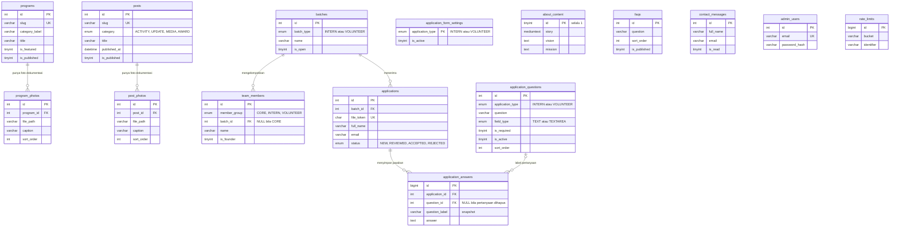

# ERD: Entity Relationship Diagram

Gambaran semua tabel MySQL dan hubungan antar tabel. DDL lengkap ada di [SCHEMA.md](SCHEMA.md). Kebutuhan produk ada di [PRD.md](PRD.md).

## 1. Diagram

Diagram menampilkan kolom kunci saja. Daftar kolom lengkap ada di [SCHEMA.md](SCHEMA.md).



## 2. Notasi teks

Notasi ini membaca "satu induk punya banyak anak". Tanda `1` berarti tepat satu, `0..N` berarti nol atau lebih, dan `0..1` berarti kosong atau satu.

```
programs      1 ----< 0..N  program_photos     (program_photos.program_id)
posts         1 ----< 0..N  post_photos        (post_photos.post_id)
batches       1 ----< 0..N  team_members       (team_members.batch_id, 0..1 di sisi anak)
batches       1 ----< 0..N  applications       (applications.batch_id)
applications  1 ----< 0..N  application_answers (application_answers.application_id)
application_questions 0..1 ----< 0..N application_answers (application_answers.question_id)

Tabel berdiri sendiri (tanpa relasi):
  admin_users, about_content, faqs, contact_messages, rate_limits,
  application_form_settings
```

## 3. Penjelasan relasi

| Relasi | Kardinalitas | Kunci asing | Saat induk dihapus | Aturan |
| --- | --- | --- | --- | --- |
| `programs` ke `program_photos` | Satu program punya nol sampai banyak foto. Satu foto milik satu program. | `program_photos.program_id` | `CASCADE` (baris foto ikut terhapus) | File fisik dihapus lebih dulu oleh `GalleryService`. Maksimal 30 foto per program. |
| `posts` ke `post_photos` | Satu berita punya nol sampai banyak foto. Satu foto milik satu berita. | `post_photos.post_id` | `CASCADE` | Sama seperti program. |
| `batches` ke `team_members` | Satu batch punya nol sampai banyak anggota. Satu anggota milik nol atau satu batch. | `team_members.batch_id` (boleh `NULL`) | `RESTRICT` (ditolak bila masih ada anggota) | Anggota grup `CORE` tidak punya batch. Anggota `INTERN` dan `VOLUNTEER` wajib punya batch dengan tipe yang cocok. Dijaga di Validator dan Model. |
| `batches` ke `applications` | Satu batch menerima nol sampai banyak pendaftar. Satu pendaftar milik satu batch. | `applications.batch_id` | `RESTRICT` | Email unik per batch. Pendaftaran hanya bisa dibuat bila `batches.is_open = 1`. |
| `applications` ke `application_answers` | Satu pendaftar punya nol sampai banyak jawaban tambahan. | `application_answers.application_id` | `CASCADE` | Jawaban ikut dihapus jika data pendaftar dihapus. |
| `application_questions` ke `application_answers` | Satu pertanyaan dapat memiliki banyak jawaban. Satu jawaban terhubung ke nol atau satu definisi pertanyaan. | `application_answers.question_id` (nullable) | `SET NULL` | Teks pertanyaan disalin ke `question_label`, jadi jawaban lama tetap bisa dibaca setelah definisi pertanyaan dihapus. |

## 4. Ringkasan tabel

| Tabel | Fungsi | Dipakai di |
| --- | --- | --- |
| `admin_users` | Akun admin. | Login admin. |
| `rate_limits` | Pencatat percobaan untuk pembatasan laju. | Login, form pendaftaran, form kontak. |
| `about_content` | Satu baris berisi cerita, visi, dan misi. | Tentang Kami. |
| `team_members` | Tim Penggerak, intern, dan relawan. Founder ditandai `is_founder`. | Tentang Kami, profil founder di Beranda. |
| `batches` | Batch intern atau relawan beserta status buka atau tutup. | Tentang Kami, form Bergabung, admin. |
| `programs` | Program beserta semua isian halaman detail. | Beranda, Program, detail program. |
| `program_photos` | Foto dokumentasi per program. | Detail program, "Dari Lapangan". |
| `posts` | Berita dan kegiatan dalam empat kategori. | Beranda, Berita, detail berita. |
| `post_photos` | Foto dokumentasi per berita. | Detail berita. |
| `faqs` | Pertanyaan umum. | Kontak. |
| `contact_messages` | Pesan dari form kontak. | Kontak, admin Pesan masuk. |
| `applications` | Data pendaftar relawan dan intern, termasuk jalur file foto dan CV. | Bergabung, admin Pendaftar, ekspor. |
| `application_form_settings` | Sakelar aktif/nonaktif formulir Internship dan Relawan secara terpisah. | Bergabung, admin Form Pendaftaran. |
| `application_questions` | Pertanyaan tambahan, jenis jawaban, kewajiban, status tampil, dan urutan per jenis formulir. | Bergabung, admin Form Pendaftaran. |
| `application_answers` | Snapshot pertanyaan dan jawaban tambahan dari pendaftar. | Detail admin Pendaftar, ekspor. |

Tabel pendukung `schema_migrations` dibuat oleh `bin/migrate.php` dan tidak termasuk diagram.

## 5. Catatan desain

1. **Tipe pendaftar tidak disimpan di `applications`.** Tipe (Intern atau Relawan) diambil dari `batches.batch_type`, sehingga satu form melayani dua tipe tanpa data ganda.
2. **Penghargaan dan Liputan Media adalah kategori di `posts`,** bukan tabel terpisah. Beranda mengambil tiga berita Penghargaan terbaru, dan halaman Berita mengelompokkannya di bagian "Diakui dan Diliput".
3. **Profil founder adalah satu baris `team_members`** dengan `is_founder = 1`. Teks profil panjang untuk Beranda disimpan di `long_bio`.
4. **`application_form_settings` hanya menyimpan sakelar dua jenis form.** Konten statis situs (hero, angka impact, peta, logo mitra, kontak) tetap berada di `config/site.php` sesuai PRD A4.
5. **Daftar sederhana disimpan sebagai teks per baris** (`activities`, `partners` di `programs`, dan `mission` di `about_content`). Pasangan label dan nilai di Informasi Program disimpan sebagai JSON (`info_rows`).
6. **`applications.file_token`** adalah nama folder file pendaftar yang acak, jadi jalur file tidak bisa ditebak dari `id`.
7. **Pendaftaran memerlukan dua status aktif:** `application_form_settings.is_active` untuk jenis formulir dan `batches.is_open` untuk batch tertentu.
8. **Aturan yang tidak bisa dijaga MySQL** (kecocokan `member_group` dengan `batch_type`, hanya satu founder, dan kesesuaian pertanyaan dengan jenis batch) dijaga di Validator dan Model. Lihat [SCHEMA.md](SCHEMA.md) bagian 5.
