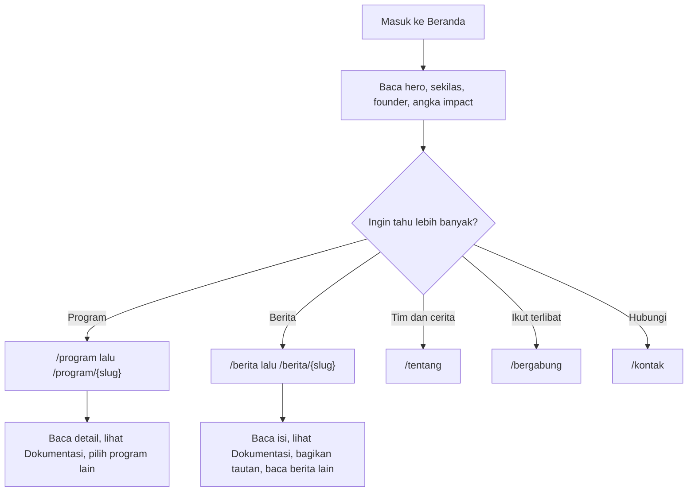
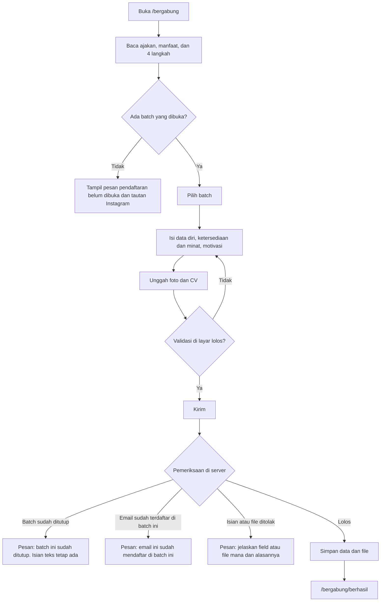
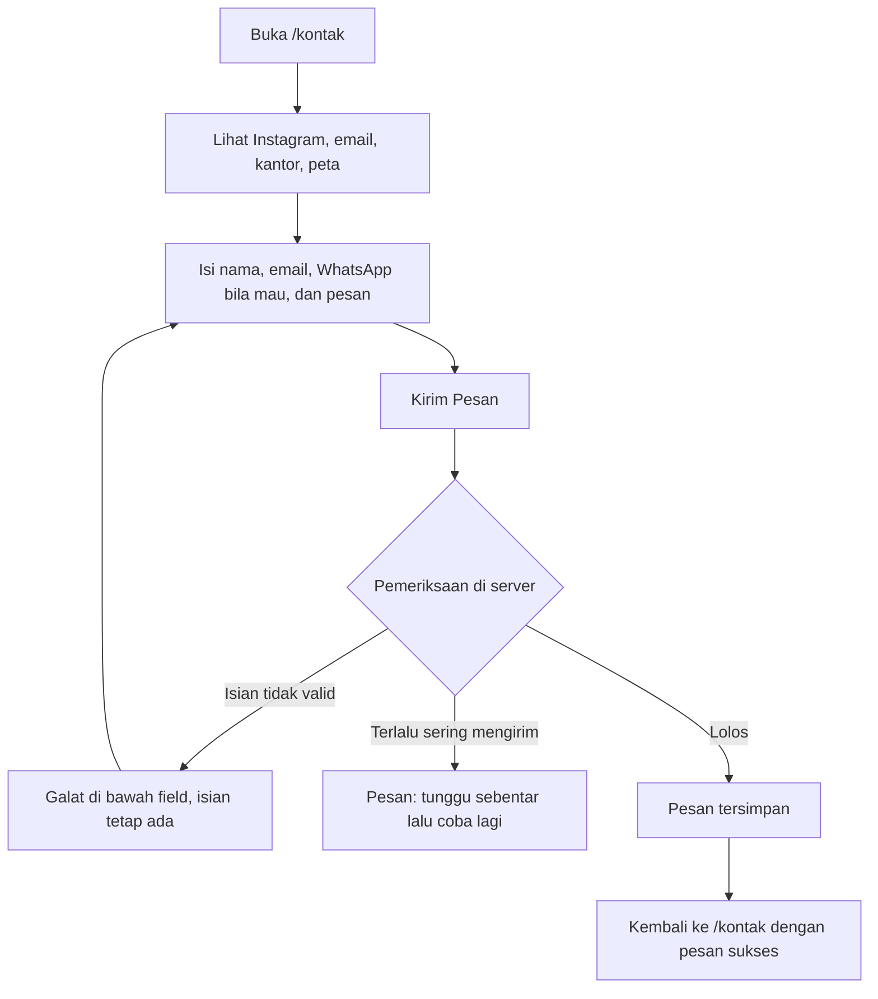
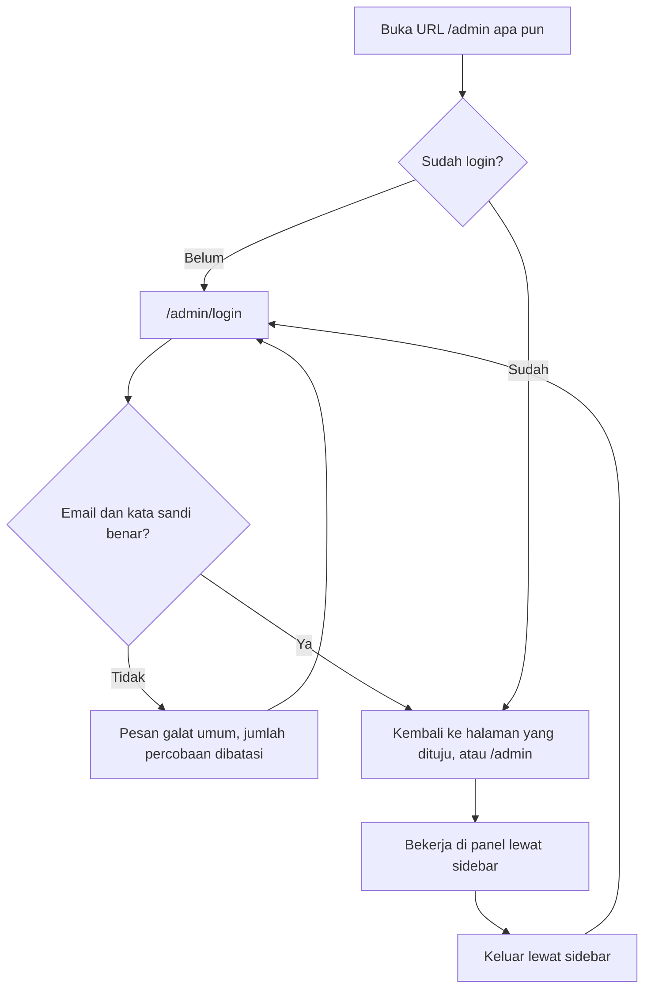
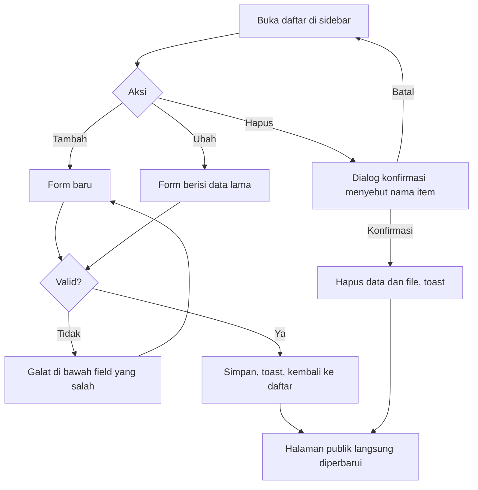
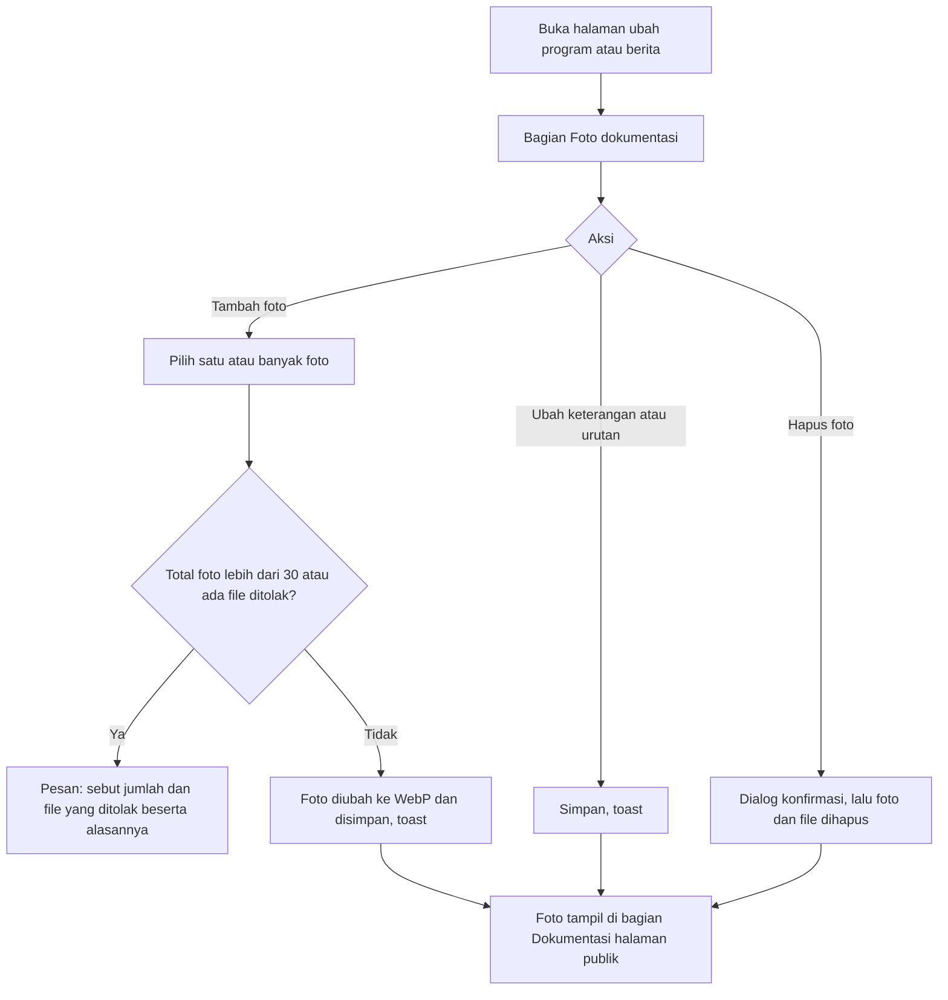
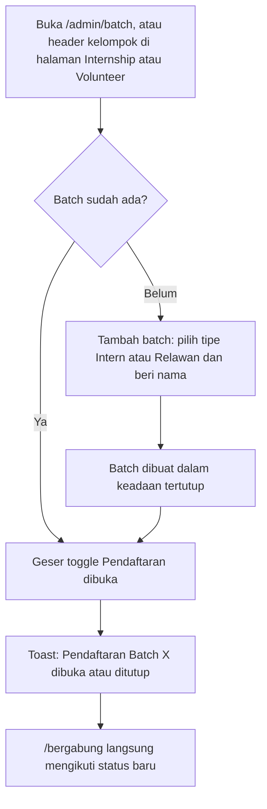
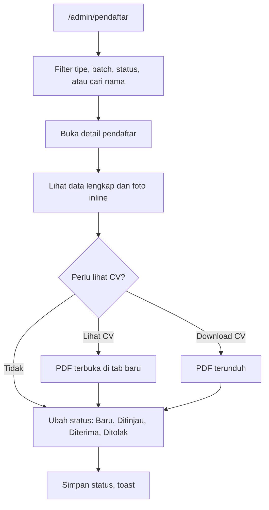
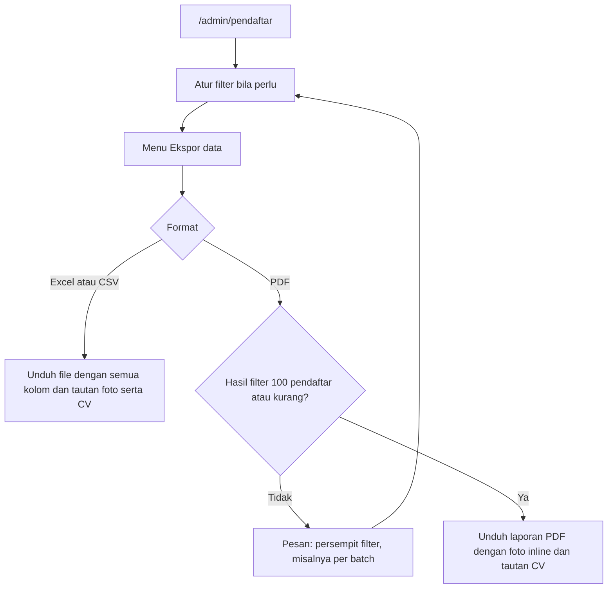
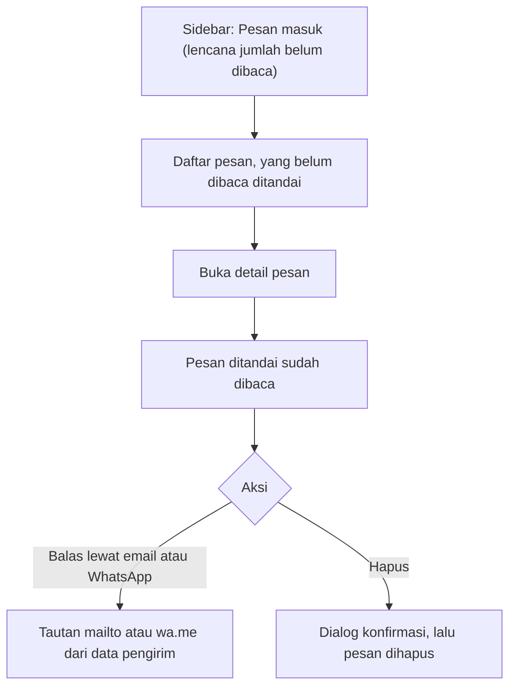

# USERFLOW

Peta halaman dan alur pengguna website Papua Future Project, untuk Public dan Admin. Kebutuhan ada di [PRD.md](PRD.md). Route lengkap ada di [ARCHITECTURE.md](ARCHITECTURE.md) bagian 6. Desain panel admin ada di [DESIGN-ADMIN.md](DESIGN-ADMIN.md).

## 1. Peta halaman

### Publik

```
/                      Beranda (hero, sekilas, founder, penghargaan, angka impact,
                       preview program, preview berita, peta wilayah)
/tentang               Tentang Kami (cerita, perjalanan, visi dan misi, Tim Penggerak,
                       Internship per batch, Volunteer per batch)
/program               Daftar program, strip angka, "Dari Lapangan"
/program/{slug}        Detail program (kegiatan, mitra, informasi, Dokumentasi)
/berita                Terbaru, semua berita (filter kategori), Diakui dan Diliput
/berita/{slug}         Detail berita (isi, bagikan, informasi, Dokumentasi, berita lain)
/bergabung             Ajakan, manfaat, langkah, form pendaftaran (bila ada batch dibuka)
/bergabung/berhasil    Konfirmasi setelah mendaftar
/kontak                Temukan kami, peta, form pesan, logo mitra, FAQ
```

### Admin

```
/admin/login
/admin                         Ringkasan
/admin/tentang                 Cerita, visi, misi
/admin/tim/penggerak           Tim Penggerak
/admin/tim/internship          Intern per batch
/admin/tim/volunteer           Relawan per batch
/admin/program                 Daftar, tambah, ubah (termasuk foto dokumentasi)
/admin/berita                  Daftar, tambah, ubah (termasuk foto dokumentasi)
/admin/faq                     Daftar, tambah, ubah
/admin/batch                   Daftar batch, buat, ubah, buka atau tutup
/admin/pendaftar               Daftar pendaftar, filter, ekspor
/admin/pendaftar/{id}          Detail pendaftar
/admin/pesan                   Pesan masuk dari form kontak
/admin/pesan/{id}              Detail pesan
```

## 2. Alur Public 1: menjelajah situs



Detail program dan berita memuat bagian Dokumentasi dari foto yang diunggah admin. Bila belum ada foto, bagian itu disembunyikan.

## 3. Alur Public 2: mendaftar sebagai relawan atau intern



## 4. Alur Public 3: mengirim pesan lewat form kontak



Pertanyaan umum dibaca di bagian FAQ pada halaman yang sama. Tiap pertanyaan membuka dan menutup jawabannya.

## 5. Alur Admin 1: masuk dan keluar



## 6. Alur Admin 2: mengelola konten

Pola yang sama dipakai untuk Program, Berita dan Kegiatan, FAQ, Tim Penggerak, Intern, Relawan, dan Batch.



Khusus Tentang Kami: admin tidak menambah atau menghapus. Admin langsung membuka satu form berisi cerita, visi, dan misi, lalu menyimpan.

## 7. Alur Admin 3: mengelola foto dokumentasi



Program atau berita baru harus disimpan lebih dulu sebelum foto bisa ditambahkan. Form tambah menampilkan catatan tentang hal ini.

## 8. Alur Admin 4: membuka dan menutup pendaftaran



## 9. Alur Admin 5: meninjau pendaftar



## 10. Alur Admin 6: mengekspor data



## 11. Alur Admin 7: membaca pesan masuk



## 12. Kasus pinggir

| Situasi | Perilaku yang diharapkan |
| --- | --- |
| Tidak ada batch dibuka | `/bergabung` tidak menampilkan form. Tampil pesan, dan bagian ajakan, manfaat, serta langkah tetap terlihat. |
| Lebih dari satu batch dibuka | Pengunjung memilih batch. Tipe (Intern atau Relawan) ditampilkan di samping nama batch. |
| Batch ditutup saat pengunjung mengisi | Pengiriman ditolak dengan pesan jelas. Isian teks tetap, file perlu dipilih ulang. |
| Pengunjung menekan kirim dua kali | Tombol nonaktif selama proses. Server tetap menolak duplikat lewat aturan email per batch. |
| File lebih besar dari batas | Ditolak di server dengan pesan yang menyebut ukuran file dan batasnya. Bila ukuran bisa dibaca di layar, ditolak lebih awal. |
| File berekstensi PDF tetapi isinya bukan PDF | Ditolak dengan pesan "File CV harus berupa PDF yang valid". |
| Pendaftar berusia di bawah 17 tahun | Ditolak dengan pesan yang menyebut batas usia. |
| Pendaftar non-mahasiswa tanpa asal universitas | Diterima. Asal universitas hanya wajib untuk Mahasiswa dan Fresh Graduate. |
| Sesi admin habis saat mengisi form | Admin diarahkan ke login. Setelah login, kembali ke halaman yang sama. Isian yang belum disimpan hilang, jadi form panjang menampilkan peringatan sebelum meninggalkan halaman. |
| Admin menghapus batch yang punya data | Ditolak. Pesan menyebut jumlah pendaftar dan anggota tim, dan menawarkan "Tutup batch". |
| Admin membuka tautan file dari Excel tanpa login | Diarahkan ke login, lalu kembali ke file setelah masuk. |
| Admin menghapus program atau berita yang punya foto | Dialog konfirmasi menyebut jumlah foto yang ikut terhapus. File fisik ikut dihapus. |
| Foto galeri melebihi 30 | Unggahan ditolak seluruhnya dengan pesan yang menyebut sisa kuota. |
| Program atau berita berstatus draf | Tidak tampil di halaman publik, tidak muncul di preview Beranda, dan URL detailnya menjawab 404 untuk pengunjung. |
| Konten kosong (belum ada program, berita, FAQ, atau tim) | Halaman publik menyembunyikan section yang kosong. Panel admin menampilkan layar kosong yang mengajak menambah. |
| Kurang dari tiga berita Penghargaan | Section Penghargaan di Beranda menampilkan sebanyak yang ada. Bila nol, section disembunyikan. |
| Pendaftar belum ada | Daftar pendaftar menampilkan layar kosong. Tombol ekspor nonaktif. |
| Pengunjung mengirim pesan kontak terlalu sering | Ditolak dengan pesan untuk menunggu. Tidak ada pesan yang disimpan. |
| Founder belum ditandai | Section profil founder di Beranda disembunyikan. |
