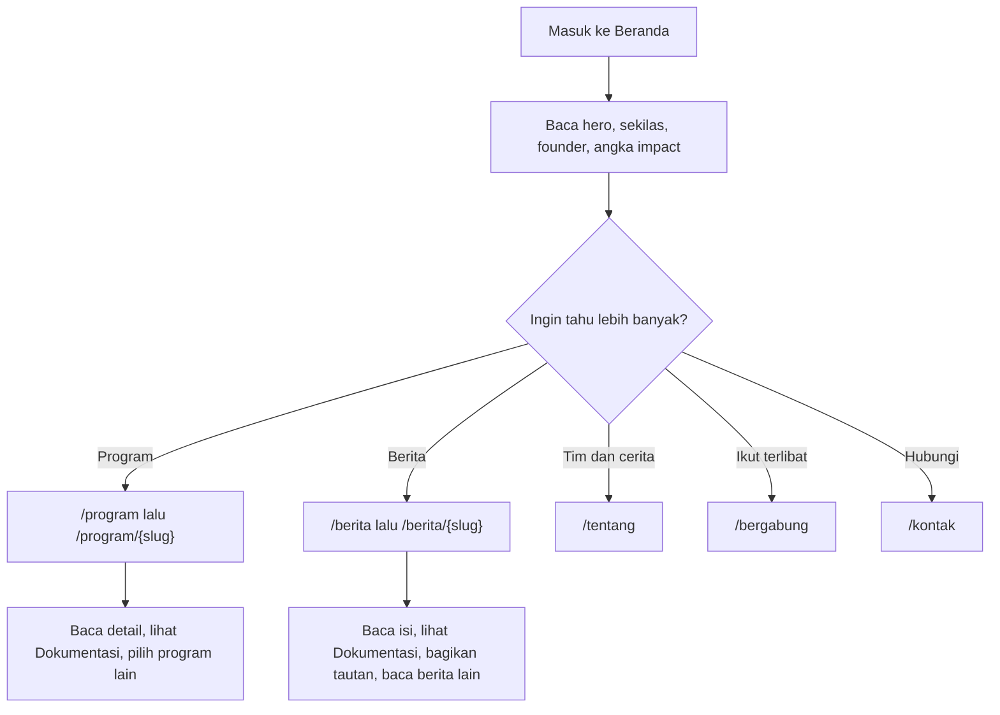
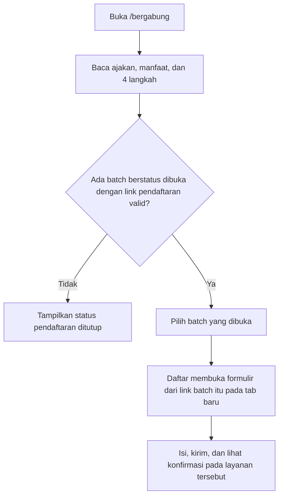
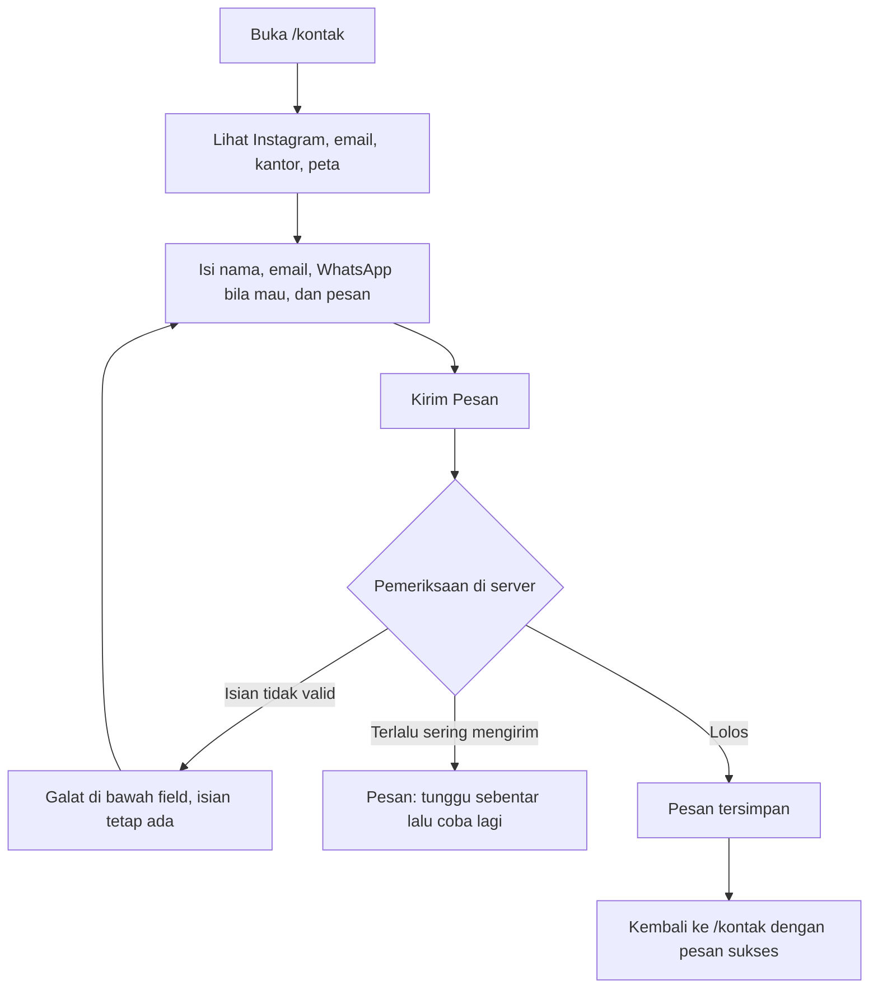
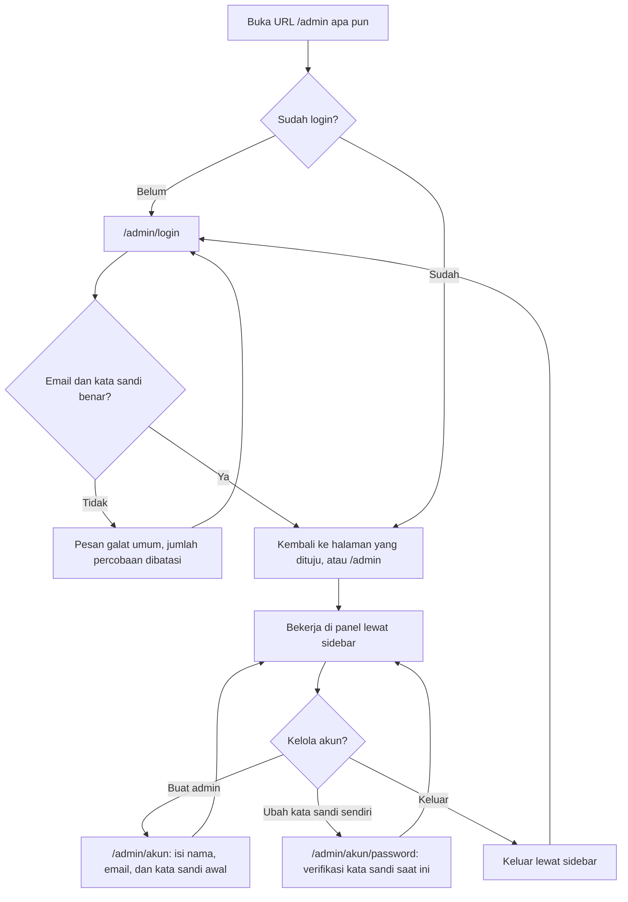
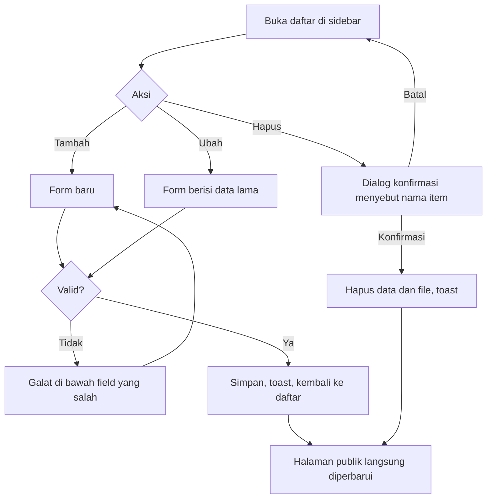
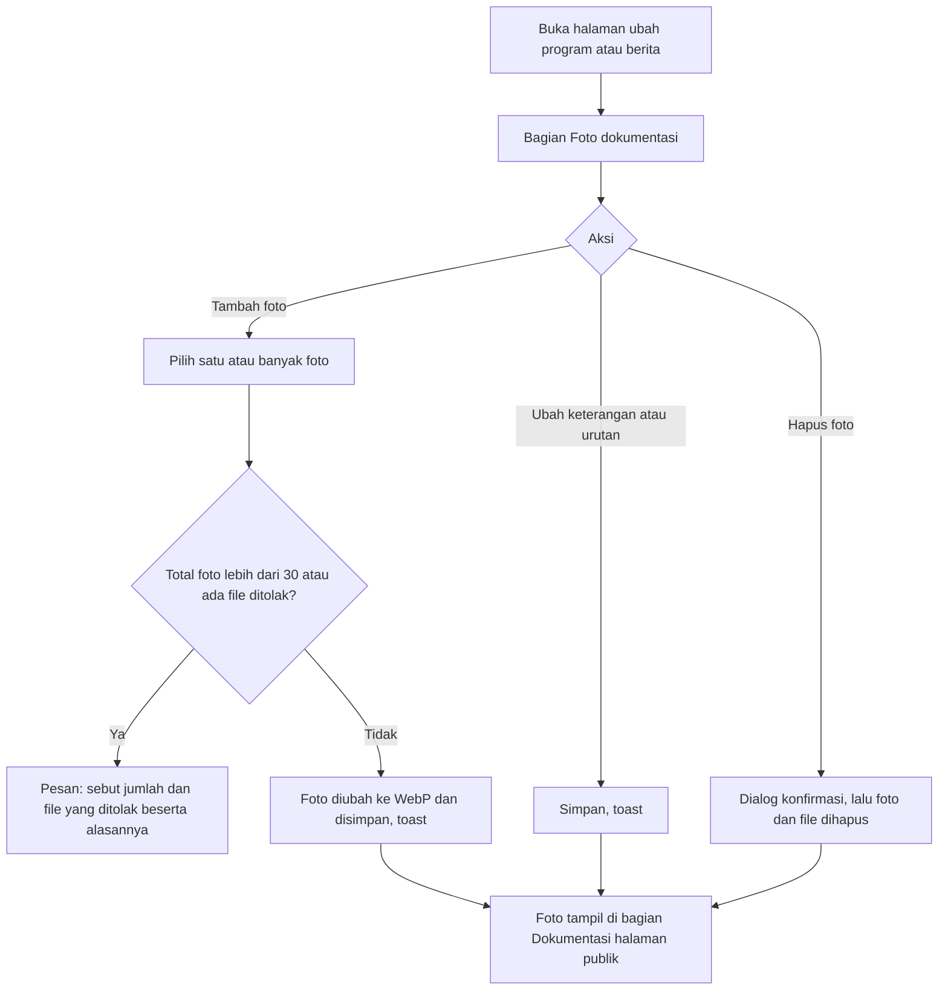
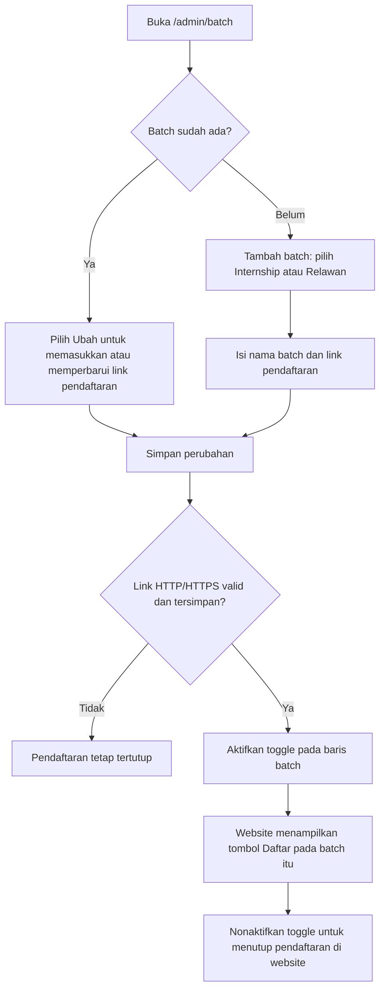
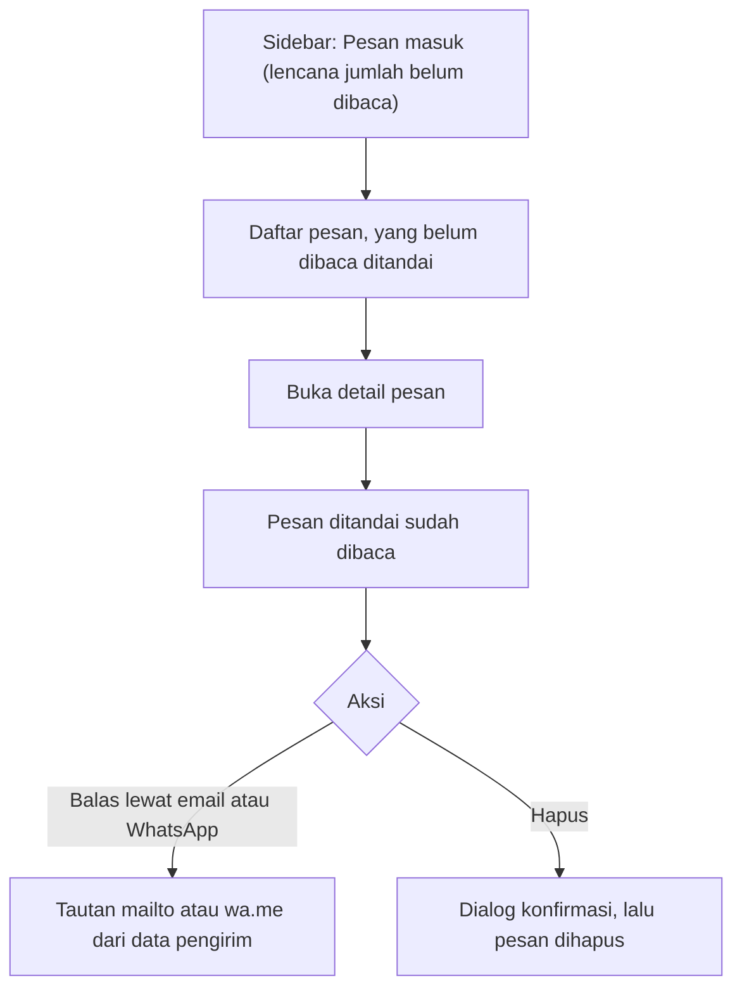

# USERFLOW

Peta halaman dan alur pengguna website Papua Future Project, untuk Public dan Admin. Kebutuhan ada di [PRD.md](PRD.md). Route lengkap ada di [ARCHITECTURE.md](ARCHITECTURE.md) bagian 6. Desain panel admin ada di [DESIGN-ADMIN.md](DESIGN-ADMIN.md).

## 1. Peta halaman

### Publik

```
/                      Beranda (hero, sekilas, founder, penghargaan, angka impact,
                       preview program, preview berita, peta wilayah)
/tentang               Tentang Kami (cerita, perjalanan, visi dan misi, Tim Penggerak,
                       Internship per batch, Volunteer per batch)
/program               Daftar program, strip angka, "Dari Lapangan"
/program/{slug}        Detail program (kegiatan, mitra, informasi, Dokumentasi)
/berita                Terbaru, semua berita (filter kategori), Diakui dan Diliput
/berita/{slug}         Detail berita (isi, bagikan, informasi, Dokumentasi, berita lain)
/bergabung             Ajakan, manfaat, langkah, dan daftar jalur/batch terbuka
Formulir eksternal     Dibuka pada tab baru setelah pengunjung memilih batch
/kontak                Temukan kami, peta, form pesan, logo mitra, FAQ
```

### Admin

```
/admin/login
/admin                         Ringkasan
/admin/tentang                 Cerita, visi, misi
/admin/tim/penggerak           Tim Penggerak
/admin/tim/internship          Intern per batch
/admin/tim/volunteer           Relawan per batch
/admin/batch                   CRUD batch, link formulir eksternal, buka/tutup pendaftaran per batch
/admin/program                 Daftar, tambah, ubah (termasuk foto dokumentasi)
/admin/berita                  Daftar, tambah, ubah (termasuk foto dokumentasi)
/admin/faq                     Daftar, tambah, ubah
/admin/batch                   Daftar batch, buat, ubah, buka atau tutup
/admin/pesan                   Pesan masuk dari form kontak
/admin/pesan/{id}              Detail pesan
/admin/akun                    Daftar akun admin dan buat admin baru
/admin/akun/password           Ubah kata sandi akun sendiri
```

## 2. Alur Public 1: menjelajah situs



Detail program dan berita memuat bagian Dokumentasi dari foto yang diunggah admin. Bila belum ada foto, bagian itu disembunyikan.

## 3. Alur Public 2: mendaftar sebagai relawan atau intern



## 4. Alur Public 3: mengirim pesan lewat form kontak



Pertanyaan umum dibaca di bagian FAQ pada halaman yang sama. Tiap pertanyaan membuka dan menutup jawabannya.

## 5. Alur Admin 1: masuk dan keluar



Admin baru dibuat dari halaman **Pengaturan → Pengelola Admin**. Kata sandi awal minimal 12 karakter dan hanya disimpan sebagai hash. Penggantian kata sandi memerlukan verifikasi kata sandi lama.

## 6. Alur Admin 2: mengelola konten

Pola yang sama dipakai untuk Program, Berita dan Kegiatan, FAQ, Tim Penggerak, Intern, Relawan, dan Batch.



Khusus Tentang Kami: admin tidak menambah atau menghapus. Admin langsung membuka satu form berisi cerita, visi, dan misi, lalu menyimpan.

## 7. Alur Admin 3: mengelola foto dokumentasi



Program atau berita baru harus disimpan lebih dulu sebelum foto bisa ditambahkan. Form tambah menampilkan catatan tentang hal ini.

## 8. Alur Admin 4: mengatur pendaftaran per batch



Tautan dan status buka/tutup disimpan per batch. Internship dan Relawan dapat dibuka bersamaan, dan setiap batch dapat memakai layanan formulir berbeda. Tombol Daftar hanya tampil jika link valid tersedia dan toggle batch aktif. Menutup batch di website menyembunyikan tombol; Admin juga perlu menutup penerimaan respons di layanan formulir jika form tidak boleh menerima kiriman lagi.

## 9. Data pendaftar

Pendaftaran baru berlangsung di layanan eksternal pada link batch. Daftar jawaban, status seleksi, foto, CV, dan ekspor dikelola dari layanan tersebut; panel admin website tidak menyediakan halaman pendaftar atau ekspor untuk data dari layanan eksternal. Tabel lokal dari formulir website versi terdahulu tetap dipertahankan sebagai arsip dan pengaman relasi batch, tetapi bukan bagian alur admin saat ini.

## 10. Alur Admin 5: membaca pesan masuk



## 12. Kasus pinggir

| Situasi | Perilaku yang diharapkan |
| --- | --- |
| Tidak ada batch dibuka | `/bergabung` menampilkan status pendaftaran ditutup. Bagian ajakan, manfaat, dan langkah tetap terlihat. |
| Lebih dari satu batch dibuka | Pengunjung memilih batch. Tipe (Intern atau Relawan) ditampilkan di samping nama batch. |
| Link pendaftaran batch belum diisi | Toggle tidak dapat dibuka dan tombol Daftar tidak tampil di website. |
| Batch ditutup setelah tab formulir dibuka | Website menyembunyikan tautan bagi kunjungan berikutnya. Tab formulir yang sudah terbuka tetap mengikuti status penerimaan respons di layanan tersebut. |
| Sesi admin habis saat mengisi form | Admin diarahkan ke login. Setelah login, kembali ke halaman yang sama. Isian yang belum disimpan hilang, jadi form panjang menampilkan peringatan sebelum meninggalkan halaman. |
| Admin menghapus batch yang punya anggota tim | Ditolak agar relasi anggota tidak rusak. Arsip pendaftar lokal lama tetap tersimpan dengan `batch_id` kosong bila batch dihapus. |
| Admin menghapus program atau berita yang punya foto | Dialog konfirmasi menyebut jumlah foto yang ikut terhapus. File fisik ikut dihapus. |
| Foto galeri melebihi 30 | Unggahan ditolak seluruhnya dengan pesan yang menyebut sisa kuota. |
| Program atau berita berstatus draf | Tidak tampil di halaman publik, tidak muncul di preview Beranda, dan URL detailnya menjawab 404 untuk pengunjung. |
| Konten kosong (belum ada program, berita, FAQ, atau tim) | Halaman publik menyembunyikan section yang kosong. Panel admin menampilkan layar kosong yang mengajak menambah. |
| Kurang dari tiga berita Penghargaan | Section Penghargaan di Beranda menampilkan sebanyak yang ada. Bila nol, section disembunyikan. |
| Pengunjung mengirim pesan kontak terlalu sering | Ditolak dengan pesan untuk menunggu. Tidak ada pesan yang disimpan. |
| Founder belum ditandai | Section profil founder di Beranda disembunyikan. |
